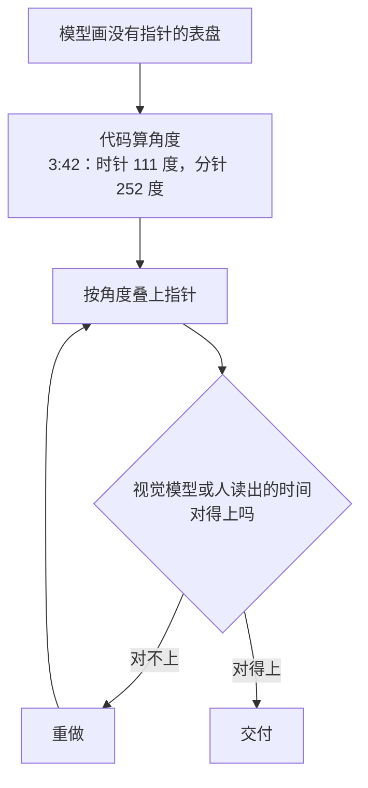

## Q
产品需要"指针指向 3:42 的手表图"或"倒满的杯子"，模型老画不对，怎么办？

## A
**别指望靠措辞说服模型：精确的部分用代码画，让模型只画它擅长的，再用另一个模型或人检查。**

场景：电商要 200 张手表图，每张时间不同，试画后发现几乎都是 10:10。

**做法：**
1. 换用更新的、会推理或能检查自己输出的模型，一次生成几张，选对的。
2. 精确部分程序化：先让模型画没有指针的表盘，再用代码按角度叠上指针。
3. 用局部编辑代替重画：出图后只改指针，不动其他部分。
4. 验收：用视觉模型或人读出图上的时间，对不上就重做。

```python
def hands(h, m):
    # 12 点为 0 度，顺时针
    hour = (h % 12) * 30 + m * 0.5
    minute = m * 6
    return hour, minute

print(hands(3, 42))   # (111.0, 252.0)
```

3:42 时，时针在 111 度，分针在 252 度。时针每小时走 30 度、每分钟走 0.5 度，所以不是正指 3。



**代价：** 精确做法多一道工序，但验收变成可以量的事。需要的是"确定的画面"时，别让概率模型碰它能算出来的部分。
