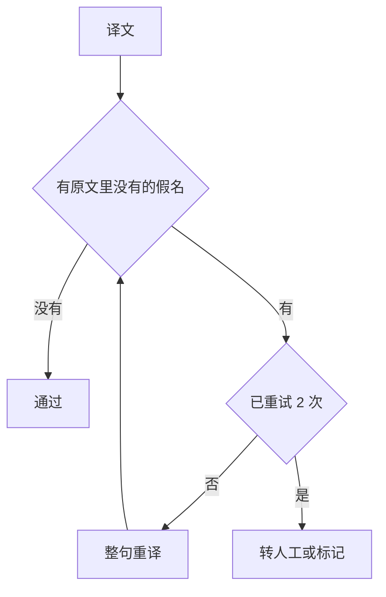

## Q
**挑战。** 你们的中文翻译产品把日文商品页译成中文。上线后约 2% 的译文里夹着假名，用户投诉。同事想加一个"出现假名就重试"的过滤器。请设计检测和兜底，并说明哪里会误伤。

## A
**评分点（答出 3 条算过）：**

1. 误伤：原文本来就有日文商品名，译文保留原名是对的；检测要和原文对照，只拦"原文里没有的假名"。
2. 重试：抽样有随机性，重试多半能修好；限制次数（如 2 次），超限转人工或标记，防止无限循环和成本翻倍。
3. 不要事后删字：直接删掉假名会破坏句子，应该整句重译。
4. 监控：按入口、模型版本、时间记录触发率；突然阶跃上升而提示没变，要怀疑服务故障而不是模型习惯。
5. 预防：提示里写明目标语言并保留专名的规则，把规则放在靠近输出的位置，再给一两个例子。

参考答案
检测用正则找假名和谚文，但先把原文里出现的专名从检测里排除，否则会把正确保留的日文商品名当错误。命中后整句重译，最多两次，仍失败就标记转人工，不要事后删字。每次触发都记录入口、模型版本和时间，如果比例在没改提示的情况下突然跳升，应当先查服务端而不是怪模型。预防上把目标语言和专名保留规则写在提示靠近输出的位置，并给例子，能压低但不能消除。

