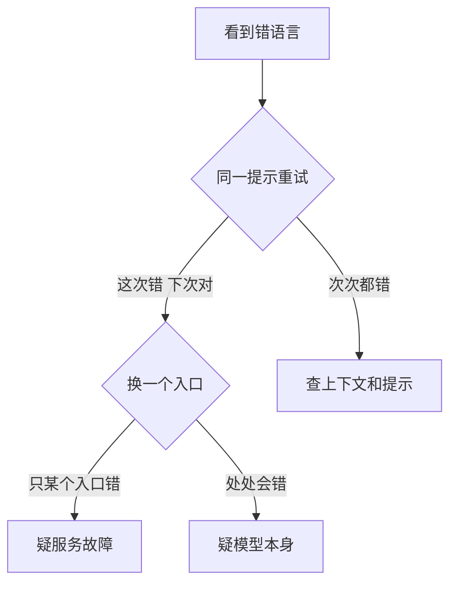

## Q
英文回答里冒出泰文或中文字符，一定是模型自己的毛病吗？2025 年 Anthropic 公布的那次事故说明了什么？

## A
**不一定：2025 年 8 月，一次服务器配置错误让本该极少出现的 token 偶尔得到高概率，用户在英文回答里看到泰文、中文字符和代码语法错误；那是部署故障，不是模型的习惯。**

| 故障 | 时间 | 症状 |
|---|---|---|
| TPU 服务器的配置错误 | 8 月 25 日起，9 月 2 日回滚 | 英文里夹着"สวัสดี"这类泰文、中文字；影响 Opus 4.1、Opus 4、Sonnet 4 |
| 近似 top-k 的编译器缺陷 | 8 月 25 日触发，Haiku 3.5 于 9 月 4 日回滚 | 偶尔把概率最高的 token 丢掉 |

两个故障都没有影响第三方云平台上的同名模型。同一个提示可以连续两次一对一错，所以看起来像随机变差。

这张判断图是经验做法，不是官方流程。

**新进展（2025 年 9 月）。** Anthropic 发布复盘，把近似 top-k 改回精确 top-k，接受一点效率损失。这类 bug 难发现，是因为抽样每一步独立，只有被放大的那一步出错，而 Claude 常能从孤立的错误后接着写通顺。

想一想：一个 bug 只是偶尔放大了某些低概率 token，为什么用户看到的是"突然冒出一个泰文字"，而不是整段乱码？
因为每一步都是独立抽样，只有被放大的那一步抽错，错的是一个 token；之后模型照常接着写，所以症状是零星的怪字，而不是整段崩坏。

