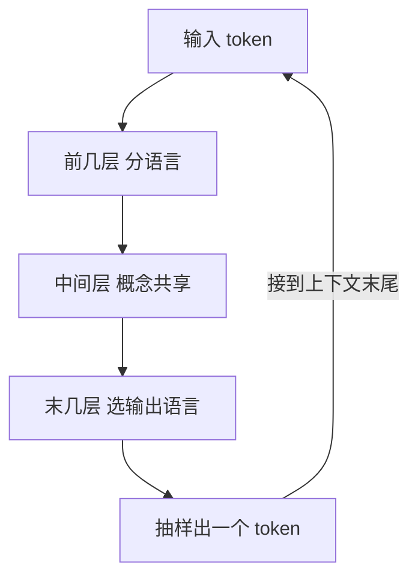

## Q
用中文提问，回答写到一半突然冒出一句韩文或日文。模型为什么会"串语言"？

## A
**模型内部的概念不分语言，用哪种语言写出来是最后几层才决定的；这一步信号弱或抽样抽偏，就会滑到邻近的语言，而且写出一个之后，下一个更容易接着写。**

例：「这个函数会返回计算の結果」，中间冒出一个日文助词，后面可能整句变日文。

- **概念共享：** 对 Claude 3.5 Haiku 的内部追踪显示，用英文、法文、中文问"small 的反义词"，激活的是同一批"小""反义"特征；只有靠近输入和输出的层才分语言。模型越大，共享的特征越多。
- **邻居太近：** 中、日、韩共用大量汉字，分词后相邻的 token 常常在几种语言里都出现，"该写哪种语言"的信号比中文对英文弱得多。
- **一步偏，步步偏：** 生成是一个 token 接一个 token，抽出的假名成了下一步的上下文，让日文更可能继续。
- **没有定论：** 某一次到底滑向韩文还是日文，上面几条各占多少，没有人公开证明过，属于「推测」。
