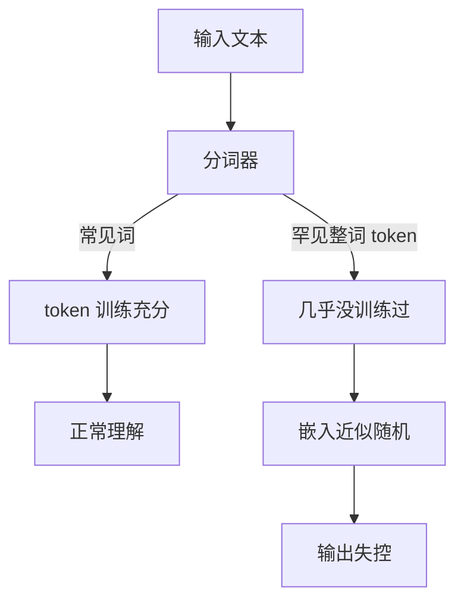

## Q
为什么有些莫名其妙的字符串（比如 SolidGoldMagikarp）会让模型胡言乱语？它和普通的生僻词有什么区别？

## A
**词表里有这个 token，但训练文本里几乎没出现过，它的嵌入（embedding，token 对应的那一行向量）从没被训练好，模型读到它就像读到乱码。**

**成因：** 分词器是在一批数据上建的词表，模型却在另一批数据上训练。某个字符串在前一批里很常见（于是有了专属 token），在后一批里几乎没有。这个 token 的嵌入停在初始值附近。2023 年在 GPT 系列上发现了这类例子，其中 SolidGoldMagikarp 一般认为与论坛用户名有关，这一点属于「推测」。

**区别：** 普通生僻词（比如"魑魅魍魉"）会被拆成几个常见的字节或字符 token，每一块都训练过，模型照样懂。出问题的是"词表里有、训练里没有"的整词 token，和这个词常不常见无关。

**证据：** 2024 年的 EMNLP 论文（Land 和 Bartolo）用嵌入向量的范数、与其他 token 的余弦距离等指标，自动找出未充分训练的 token，并在许多不同的模型里都找到了。

**产品里怎么咬人：** 用户输入或抓来的网页里夹带这类字符串，模型会拒答、乱答或胡编。对策是输入规范化和过滤，并把它们加入回归测试；根治要换词表或补训练，那是模型厂商的事。
