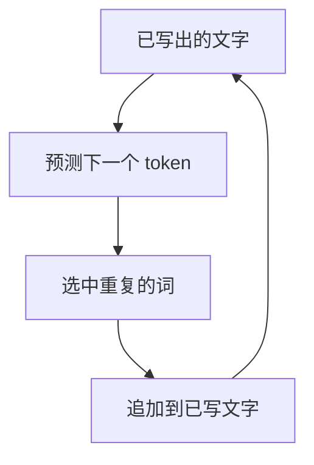

## Q
模型为什么会一遍遍重复同一句话，停都停不下来？

## A
**模型的每个 token 都以"前面已经写出的全部文字"为条件，而它自己刚写的重复也在这些文字里：重复得越多，下一个 token 越倾向于继续重复。**

例子：回复变成"好的，我来帮你。好的，我来帮你。好的，我来帮你……"，一直写到长度上限。

**已知的机制：**
- 实测（NeurIPS 2022）：一个句子在上下文里出现的次数越多，模型接着写它的概率越高；模型还偏爱重复上一句。
- 贪心解码（greedy，每次取概率最大的 token）或温度很低时，一旦"重复"成了最大概率，就再也抽不到别的。
- 所以对策不是劝它别重复，而是改解码和外围：适度温度，或重复惩罚（对已出现过的 token 降分）；设 max_tokens；程序检测到重复就截断重试；别把循环的内容留在对话历史里。

**新进展（2025 年 12 月 – 2026 年 3 月）。** 两篇论文研究推理模型（先长篇思考再作答的模型）为何陷入循环。一篇发现语义上的绕圈先出现、文字重复在后，能从隐藏状态里提前察觉。另一篇（ICML 2026）发现低温时循环常见，蒸馏出来的小模型比老师更爱循环，调高温度只是权宜之计。

想一想：长思考陷入循环时，"调高温度再试一次"为什么常常有效，却不是根治？
高温让它有机会跳出概率最大的重复分支，所以重试常能走出来；但训练中没学好的底子没变，循环还会在别处再出现，而且生成会变得更长。

