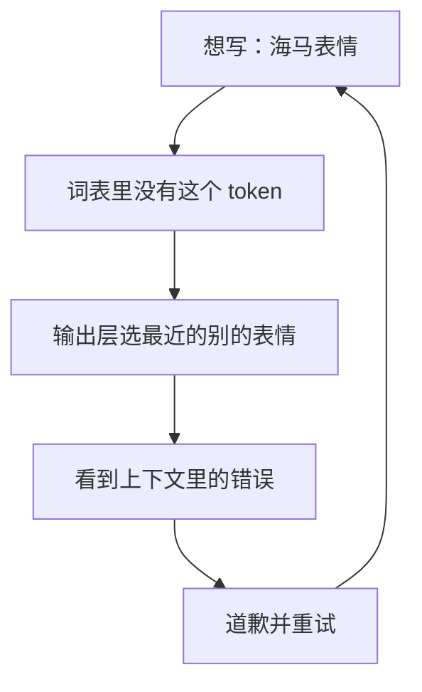

## Q
问模型"有没有海马表情"，它为什么会信誓旦旦地说有，然后吐出一串错的表情停不下来？

## A
**模型心里有"海马加表情"这个意思，但词表里没有对应的 token，输出层只能挑最接近的别的表情；它写出来才看到不对，再试，又错。**

**事实：** Unicode 里没有海马表情（2018 年的提案被拒）。但被问 100 次"有没有"，gpt-5-chat、gpt-5 和 Claude 4.5 Sonnet 每次都答"有"。要它写出来，常得到鱼、马或别的海洋动物，有的模型就这样一圈圈绕下去。

**机制：** 最后一步是把模型内部的向量和词表里每个 token 的向量比较，取最像的。向量表示的是"海马加表情"，最像的是🐠或🐴，于是输出了它们。直到错的 token 被追加进上下文，模型才有机会发现不对；下一圈又由同一个输出层选词，所以会重复同样的错误。这就是你学过的生成循环。

**「推测」：** 有分析者猜测，强化学习让模型有机会在试错中学到输出层的行为，所以经过强化学习的模型更能自我纠正；尚无定论。

**怎么做：** 同样的坑也出现在不存在的函数名、不存在的 API 上。"某物是否存在"要查权威资料，不要问模型；长输出设 max_tokens；程序检测到重复就截断。

**新进展（2025 年 10 月）。** 一篇分析把输出层套在 Llama-3.3-70B 的中间层上看它在"想"什么：中间层里确实出现了 sea、horse 的概念，到最后一层却被映射成热带鱼🐠。同样的问法对"鱼表情"就正常，因为词表里有。

想一想：模型明明在上下文里"看见"了自己写错的表情，为什么还会继续重试出错？
看见只是让它知道错了，但下一次选词仍由同一个输出层完成，而词表里仍然没有正确答案；上下文里连续的"再试一次"还会让下一次更像上一次。

