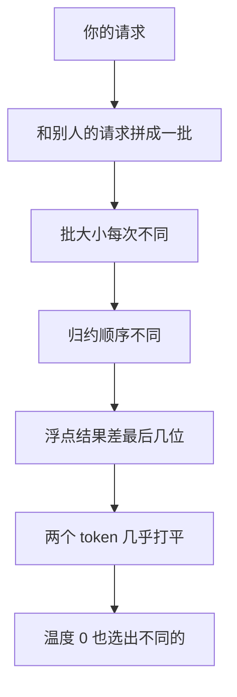

## Q
温度已经设成 0，同一个提示为什么还是会得到不完全一致的回答？

## A
**温度 0 只让"挑 token"变成取最大值，但算出来的数会随服务器当时的批大小（batch size）微微变化；两个候选几乎打平时，最后几位的差就能挑出不同的 token。**

- **为什么是顺序：** 浮点加法不满足结合律，(a+b)+c 和 a+(b+c) 差最后几位。矩阵乘法、归一化（RMSNorm）、注意力在不同批大小下，加的顺序不同。
- **一个实验：** 对 Qwen3-235B 问同一句"Tell me about Richard Feynman"，温度 0，生成 1000 次、每次 1000 个 token：得到 80 种不同的回答，最常见的一种出现 78 次；前 102 个 token 完全一致，第 103 个开始分叉（992 次接 "Queens, New York"，8 次接 "New York City"）。
- **修法：** 批不变（batch-invariant）内核，让每个请求的结果不依赖批大小；同一个实验 1000 次全部相同。
- **代价：** 在一个 8B 模型的小测试里，1000 条序列从 26 秒变成 42 到 55 秒，约慢 1.6 到 2.1 倍。

**新进展（2025 年 9 月）。** 这个解释公开后，SGLang 等推理引擎陆续提供确定性推理模式（需要特定的注意力后端），代价是吞吐下降，各家测得的数字不一。

想一想：哪类业务值得为批不变内核付出一倍左右的速度代价？
需要逐字可复现的场景：评测对比、故障复现、审计留痕。普通聊天用户不在乎一个词的差别，不值得。

