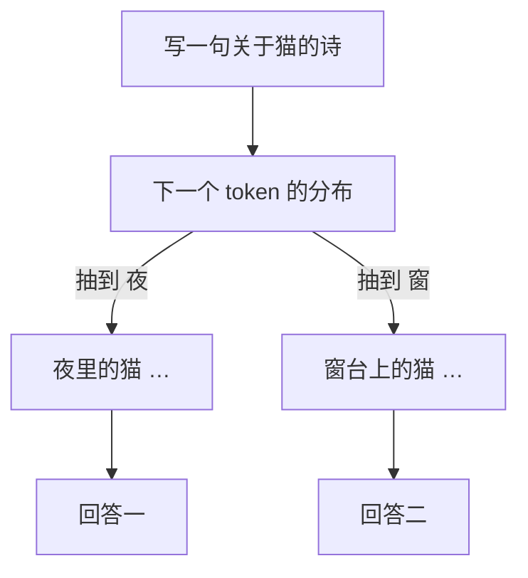

## Q
同一个问题问两次，模型给了两个不同的答案。这是 bug 吗？

## A
**不是 bug：模型每一步输出的是一个概率分布，再从分布里抽一个 token（采样）；抽到不同的 token，它就成了后面的上下文，两条路越走越远。**

- **温度（temperature，控制分布尖锐程度）：** 越高越敢抽冷门词，越低越集中；设成 0 就每步取最大值（贪心）。
- **是特性：** 写文案、起名要多样；做分类、抽取要稳定。同一个任务，你要的"一致"程度不同，用法不同。
- **一次分叉就够了：** 回答 300 个 token，只要第 5 个抽得不同，后面 295 个都跟着变。
- **温度 0 不是保证：** 它只保证"选最大值"这一步是确定的；算出的概率本身会随服务器把哪些请求拼成一批而有微小差别。

**新进展（2026 年 4 月 – 11 月）。** 较新的 Claude 模型不再让你调采样参数：以 Opus 5.5 的迁移指南为例，要求在请求里省略 temperature、top_p 和 top_k，用提示词引导行为。指南还明确提醒，temperature 为 0 在以前的模型上也从未保证过相同输出。

想一想：平台把采样旋钮收回去之后，需要可复现输出的人该怎么办？
旋钮本来也保证不了；要复现得在应用层做：缓存第一次的结果、固定提示和模型版本、对结构化输出做校验，或自己部署并打开确定性推理模式。

