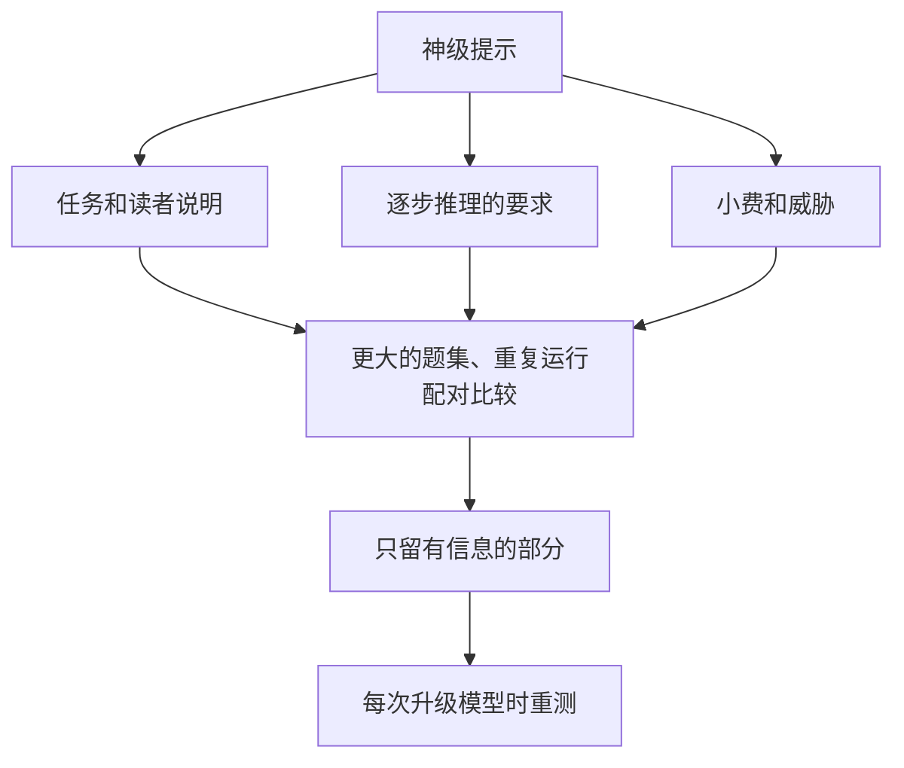

## Q
**挑战。** 同事分享他的"神级提示"：开头一句"你是世界顶级专家，我给你 200 美元小费，答错我会被开除"，再加全大写的"CRITICAL: 必须逐步推理"。他说换上之后，自己试的 20 道题正确率从 14 道升到 17 道。团队打算把这段写进所有项目的模板。你怎么回应，怎么验证？

## A
**评分点（答出 3 条算过）：**

1. 20 道题、一次运行，差 3 道题在噪声范围内：单题上涨跌方向近乎随机，无法证明有效。
2. 验证方法：固定一批更大的题集，每个版本重复运行多次，用同一评分标准，做配对比较并看方差。
3. 已有的大规模测试里，威胁和小费平均没有显著效果，单题可涨可跌；礼貌过低有害，过度礼貌也没用。
4. 全大写的强调在新一代模型上可能导致过度执行；模板里应删除补偿性的强调，并在每次升级模型时重测。
5. 拆开比较：哪一句真的起作用？把"任务和读者说明""逐步推理的要求""小费和威胁"分别做对照，保留有信息的那部分。

参考答案
20 道题多对 3 道不足以说明问题，单题上的涨跌近乎随机，需要更大的题集、重复运行和配对比较。公开的大规模测试里，小费和威胁平均没有显著效果，全大写的强调在新一代模型上还可能被过度执行。我会把这段提示拆成几部分分别做对照：任务和读者说明、逐步推理的要求、小费和威胁，只把有信息的部分写进模板，并在每次换模型时重跑评测。

