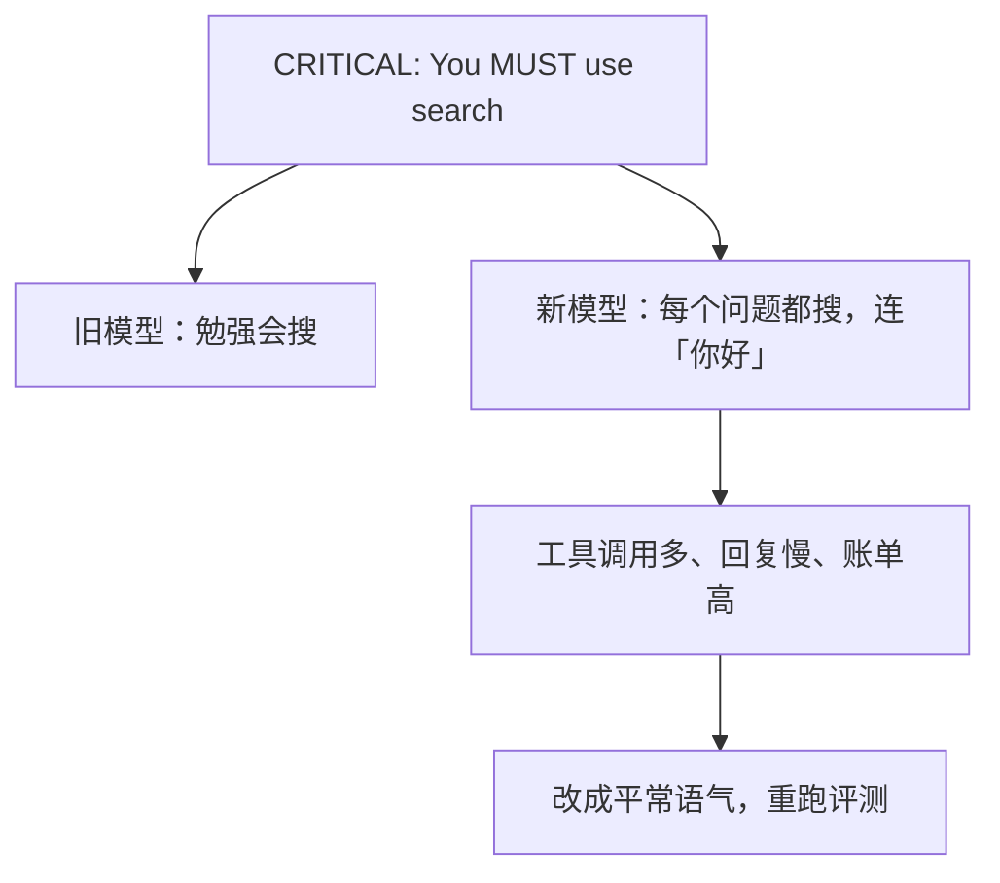

## Q
旧提示里写满大写的"CRITICAL: 你必须……"，换成新一代模型后反而出问题，为什么？

## A
**新一代模型更听系统提示的话：为了弥补旧模型"不够听话"而加的强调，到了新模型上会被过度执行。**

场景：旧提示为了让旧模型肯用搜索工具，写了这样一句。

```
CRITICAL: You MUST use search for EVERY question.
```

旧模型读了勉强会搜。新模型每个问题都搜，连"你好"也搜，工具调用变多，回复变慢，账单变高。



Anthropic 的官方提示指南（截至 2026 年 11 月）写到：Claude Opus 4.5 和 4.6 比以前的模型更听系统提示的话，原先为减少"该用没用"而加的强硬措辞，现在可能导致过度触发；建议改成平常的语气。

```
Use search when the answer depends on recent facts.
```

**教训：**
- 偏方是对着某一代模型的毛病调出来的，换代就可能失效甚至反噬。
- 升级模型时，把旧提示里"补偿性"的强调当作待清理的清单：删掉后重跑评测，看分数是否不降反升。
- 需要强约束的地方（比如不可逆操作），不要靠语气，靠程序里的权限和确认步骤。
