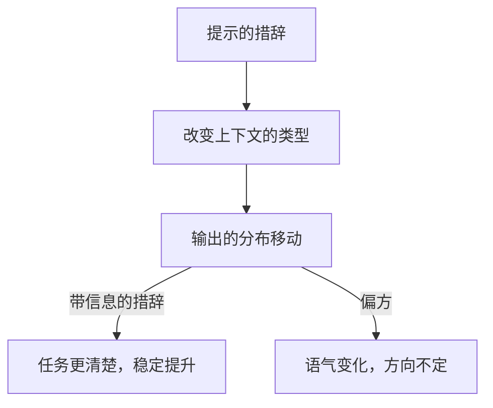

## Q
在提示里说"请"、许诺小费、威胁它、"这对我的职业生涯很重要"，为什么有时输出真的会变？这些偏方有用吗？

## A
**措辞会改变输出，因为它改变了模型"接着往下写"的那类文字；但这是顺带的效应，效果小、不稳定、换一代模型就变。**



模型预测的是"这样的开头后面通常接什么"。"这对我很重要"会让语气更认真、篇幅更长，但更长不等于更准。

```
偏方：我给你 200 美元小费，答对再加。
偏方：答错我就会被开除。
有效：读者是财务总监，要季度摘要。
有效：3 点，每点不超过 30 字，附数字。
```

区别在于信息：后两行告诉模型任务的形状，前两行没有。

**新进展（2025 年 8 月）。** 沃顿商学院（Wharton）的团队直接检验了"威胁模型它会做得更好"（Google 联合创始人 Brin 的说法）和"许诺小费"。他们在 GPQA Diamond（198 道研究生水平选择题）和 MMLU-Pro 上多次重复运行：平均来看没有显著效果，但单道题上有的涨有的跌，幅度可达约 30 个百分点，事先无法预测。

<details class="pt"><summary>想一想：在自己的 20 道题上试了一个偏方，分数涨了，能说明它有效吗？</summary>不能。单题上涨跌方向近乎随机，样本这么小很可能只是噪声；要用足够多的题、重复多次运行并做配对比较，才能判断。</details>
