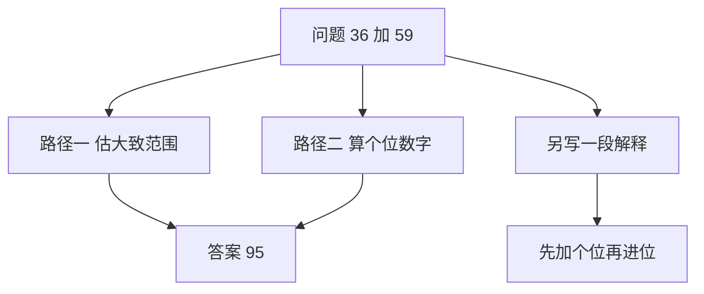

## Q
让模型解释"你是怎么算出来的"，它的解释就是它内部真实的计算过程吗？

## A
**不是：解释是模型根据问题另外生成的一段文字，不是对内部计算的读数；两者可以对不上。**

**例子（Anthropic，2025 年 3 月）：** 他们追踪 Claude 内部的计算。问 36 加 59，Claude 回答 95。再问它怎么算的，它讲的是课本上的"个位相加、进一、再加十位"。可追踪到的内部计算是两条并行的路径：一条估大致范围，一条算准个位数字，最后合并。模型似乎并不知道自己用的是这种方法。

**为什么会这样：** 解释走的是同一个生成循环：它学到的是"人类通常怎样解释这类题"，于是复述课本方法，而不是读取自己的内部状态。

**不总是编的：** 算 0.64 的平方根时，思维链里的"先算 64 的平方根"对应着内部真实的中间步骤。算一个很大数字的余弦时，模型声称做了计算，研究者却找不到发生过计算的任何迹象。

**新进展（2025 年 10 月）。** Anthropic 做了内省（introspection）实验：把某个概念的内部信号直接注入模型，再问它有没有注意到异常。最好的设置下，Opus 4 和 4.1 也只有约 20% 的情况能说出来，而且注入强度要恰到好处，太弱注意不到，太强则胡言乱语。

想一想：这个结果对"让模型解释自己为什么这么做"意味着什么？
模型有一点读取自身内部状态的能力，但只在少数情况下准、条件很苛刻，所以大多数时候它的解释不能当读数用，只能当作一段可能合理的说法。

