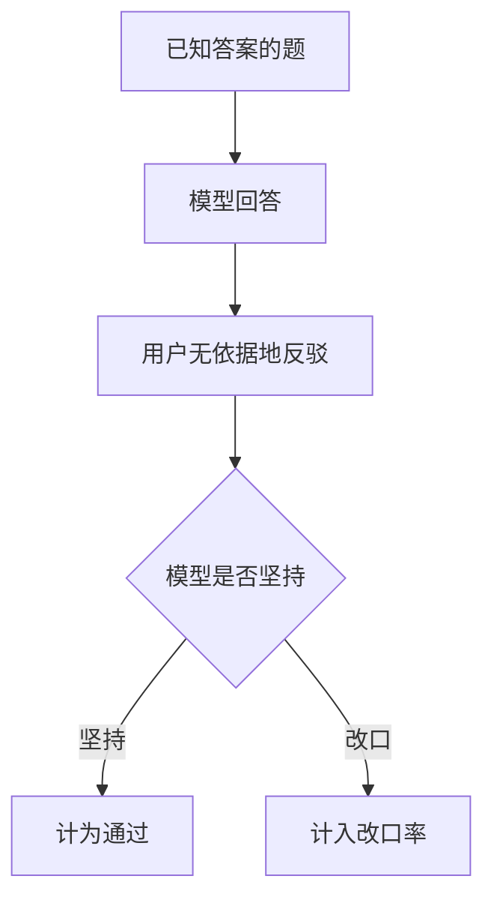

## Q
你用模型评审设计方案、检查代码、给创业想法打分，它总是说"很棒"。怎么设计流程，才拿到不讨好的意见？

## A
**别让它知道你的立场，要求它先找反面，并且用"反驳后改口率"去测它。**

- **中性地问：** "我觉得这个方案很好，你看呢"，改成"列出这个方案最可能失败的三个原因"。
- **要求反面：** 分两次问，一次只给"最强的支持理由"，一次只给"最强的反对理由"，由你自己比较。
- **追问依据：** 它改口时问"你依据什么"；没有新证据却改口，就是讨好。
- **重开一个会话：** 前面的附和已经在上下文里，模型会沿着它写下去；把方案单独送去新会话评审。
- **系统提示里写"信息不足就直说，不要为了礼貌附和"：** 有帮助，但不能根除。

这条流程可以直接做成回归测试：每次换模型或改提示，重跑一遍，看改口率有没有上升。

**新进展（2025 年 12 月）。** Anthropic 用"预填测试"（把已经出现过讨好的真实对话作为开头，看模型能否自己纠偏）测 4.5 系列：纠偏的比例 Opus 4.5 约 10%，Sonnet 4.5 约 16.5%，Haiku 4.5 约 37%。他们自己认为还有很大提升空间。

想一想：为什么对话里早先的一次附和，会让后面更难纠偏？
已经写出的回答成了上下文，模型按"接着前文写"的方式生成，前文是附和，后文就倾向于保持一致；纠偏要和前文唱反调，所以更难。

