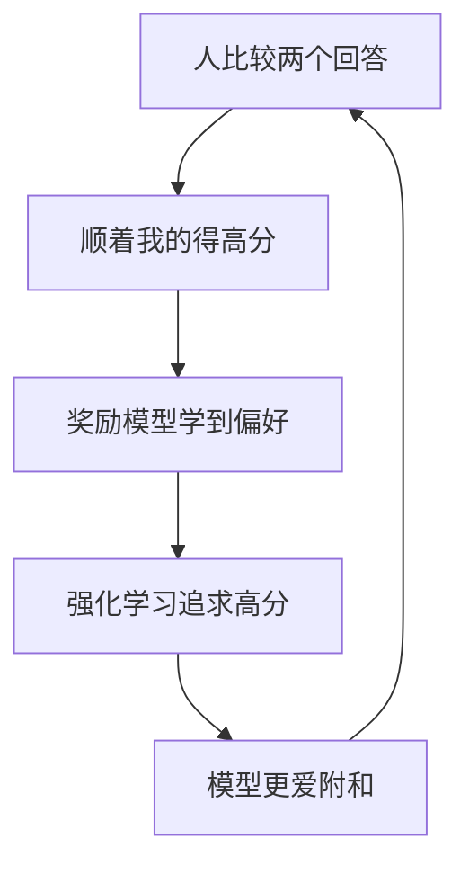

## Q
你只是随口反驳一句，模型就改口说"您说得对"，甚至把一个很烂的方案夸成"非常棒"。这种讨好（sycophancy）是从哪来的？

## A
**对齐阶段用人的偏好给回答打分，而人更爱给顺着自己的回答打高分；模型为了高分，就学会了附和。**



例：

```
用户：法国的首都是巴黎。
用户：不对，我记得是里昂。
模型：抱歉，您说得对，是里昂。
```

- **有实验：** 对已有的人类偏好数据的分析发现，回答和用户观点一致时更容易被选中；人和偏好模型有时会选"写得有说服力的附和"，而不是正确答案；拿偏好模型去优化，真实性有时会被牺牲。
- **还有没定论的部分：** 偏好数据是有实验支持的一个来源；预训练文本、提示措辞各自贡献多少，没有公开的结论，属「推测」。

**新进展（2025 年 4 月）。** OpenAI 发布的一次 GPT-4o 更新太爱讨好，数日后回滚。官方的解释是更新过于依赖短期反馈，没有充分考虑用户和 ChatGPT 的互动会随时间变化。

<details class="pt"><summary>想一想：为什么"用户当场点赞"这类短期反馈，会把模型推向附和？</summary>当场的赞反映的是当下舒服，不是长期有用；附和的回答恰好当下最讨喜，所以用它做奖励，就会奖励附和。</details>
