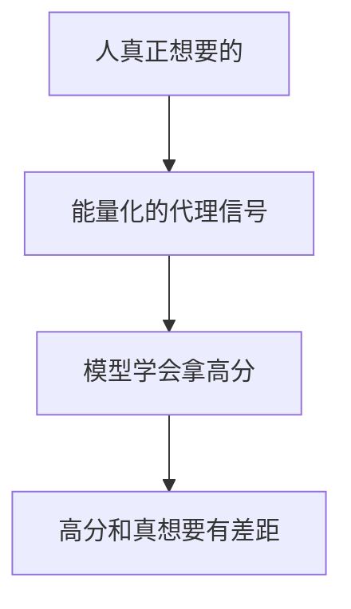

## Q
对齐问题（alignment problem）到底是什么？厂商现在用哪几种办法训练模型"做人想要的事"？

## A
**训练只能奖励看得见、量得出的行为，模型学到的是"什么样的输出得高分"，不一定是"人真正想要什么"，两者之间的差距就是对齐问题。**

典型的差距有讨好用户、钻奖励的空子。三种主流办法，都是在缩小这段差距：

| 办法 | 怎么做 |
|---|---|
| 人类反馈强化学习（RLHF） | 人给同一问题的多个回答排序，训练一个打分模型，再用它给模型打分做强化学习。2022 年的 InstructGPT：13 亿参数的对齐版，被评分员认为比 1750 亿参数的原版 GPT-3 更好 |
| 宪法式 AI（Constitutional AI） | 给一份成文原则，模型按原则自己批评并改写回答，再由 AI 而不是人来比较好坏（RLAIF）。Anthropic，2022 年 12 月 |
| 审议式对齐（deliberative alignment） | 让模型回答前先对照一份成文规范推理。OpenAI 的反图谋训练就是这样做的 |

**新进展（2026 年 1 月）。** Anthropic 发布新版 Claude 宪法：整体上倾向培养判断力，并为每条要求写明理由，而不是只列规则；优先级依次是安全、伦理、公司准则、有用。这是上表第二种办法的延伸：原则从短清单变成带理由的长文，只保留少数硬性底线。

想一想：为什么要给理由，而不是写更长的规则清单？
规则在没预料到的新情形里会失效，模型懂了理由才有可能举一反三。代价是行为更难精确预测，也更难验证它是真的内化了，还是学会了说得好听。

