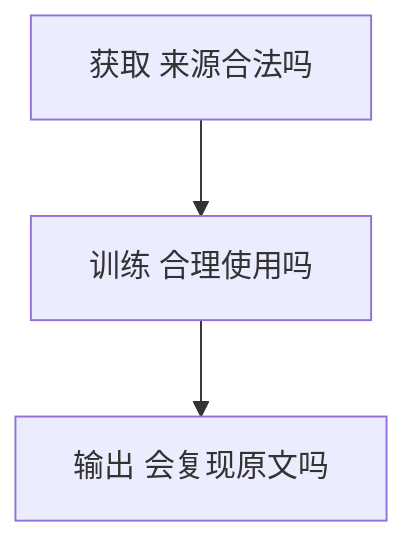

## Q
用受版权保护的内容训练 AI，到底违不违法？法院已经裁了什么？

## A
**没有一刀切的答案：法院把责任拆成三个环节分别看——数据怎么来的、训练本身、模型输出了什么；截至 2026 年 11 月，生成式 AI 的训练本身算不算合理使用（fair use），还没有上诉法院裁定。**

| 环节 | 已有裁决 |
|---|---|
| 获取 | Bartz v. Anthropic（美国，2025 年 6 月）：用买来的书训练属于合理使用，但从盗版书库下载并留存不是。2026 年 7 月 20 日，15 亿美元的和解获最终批准，约每部 3,000 美元 |
| 训练 | Kadrey v. Meta（美国，2025 年 6 月）：Meta 在该案记录上胜诉，但法官指出模型能批量生成竞争作品，"市场稀释"这种损害可能成立。纽约时报诉 OpenAI 和微软：2026 年 9 月 4 日双方提出合理使用的简易判决动议，截至 11 月 15 日未裁，也没有开庭日期 |
| 输出 | GEMA v. OpenAI（慕尼黑，2025 年 11 月 11 日）：模型里记住的歌词本身就是复制，OpenAI 要为输出负责，已表示上诉。Getty v. Stability AI（英国，2025 年 11 月 4 日）：模型权重不是侵权复制件，Getty 败诉 |

**怎么记：** 买来的、授权的数据风险低；盗版库和绕过付费墙的来源风险最高；训练是否合理使用各法院还在分歧；能逐字吐出原文的模型，在德国已被判侵权。

**新进展（2026 年 9 月）。** 9 月 29 日，第三巡回上诉法院维持 Thomson Reuters 诉 ROSS 的判决：ROSS 用 Westlaw 的案例摘要训练一个与之竞争的法律检索工具，不属于合理使用。这是第一个关于 AI 训练合理使用的上诉判决，但法院强调该工具不能生成原创内容，没有裁定生成式模型。

想一想：ROSS 的结论为什么不能直接套到 ChatGPT 这样的生成式模型上？
ROSS 的工具只检索不生成，直接替代 Westlaw，市场损害很直接。生成式模型的"转化性"以及批量生成竞争作品算不算市场损害，是另一个问题，上诉法院还没回答。

