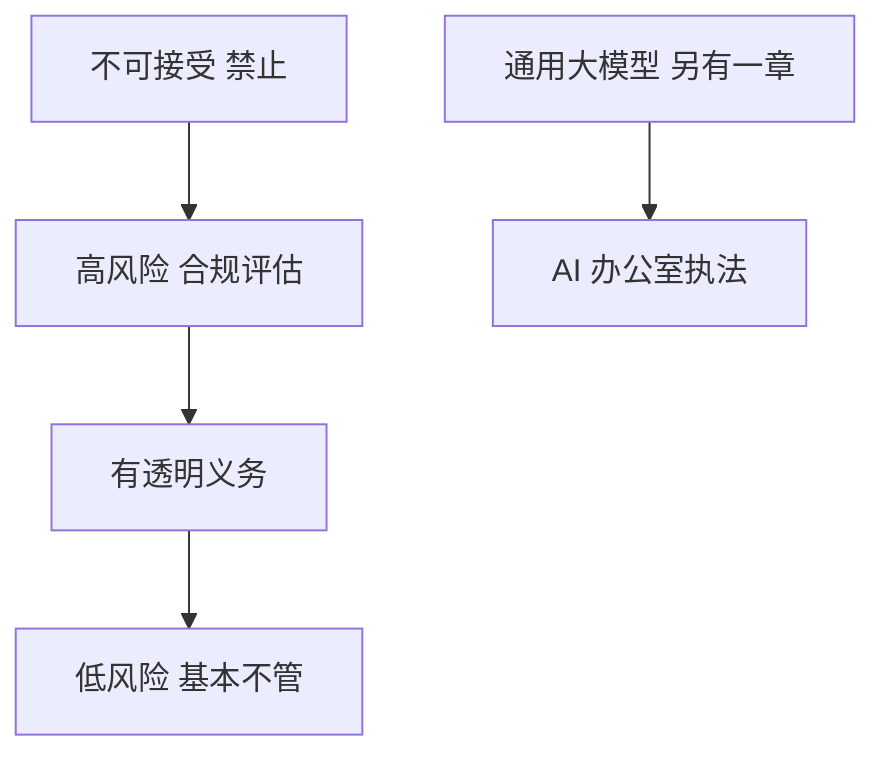

## Q
欧盟《人工智能法》（EU AI Act）怎么分级？截至 2026 年 11 月，哪些条款已经生效，哪些推迟了？

## A
**按风险分档管：不可接受的禁止，高风险的要合规评估，特定的要透明，其余基本不管；通用大模型另有一章，欧盟 AI 办公室从 2026 年 8 月 2 日起有权对其执法和罚款。**

| 日期 | 什么生效 |
|---|---|
| 2025 年 2 月 2 日 | 禁止条款（如职场情绪识别、社会评分） |
| 2025 年 8 月 2 日 | 通用大模型（GPAI）义务；训练算力超 10^25 次运算视为有系统性风险 |
| 2026 年 8 月 2 日 | AI 办公室开始对通用模型执法，最高罚 3% 全球营业额或 1,500 万欧元；聊天机器人须表明身份，深度伪造须加标 |
| 2026 年 12 月 2 日 | 新增禁止生成非自愿私密图像和儿童性虐待内容的系统；已上市生成式系统的机读水印义务宽限到此日 |
| 2027 年 12 月 2 日 | 独立的高风险系统（招聘、信贷评分等，附件 III），原定 2026 年 8 月 2 日 |
| 2028 年 8 月 2 日 | 嵌入受监管产品（如医疗器械）的高风险 AI |

最严重的违规（如触碰禁止条款）最高罚 3,500 万欧元或 7% 全球营业额。

**对照：** 美国没有联邦综合性 AI 法，只有各州的法律；中国没有统一的 AI 法，用分项规定，例如 2025 年 9 月 1 日起实施的 AI 生成内容标识办法。

**新进展（2026 年 5 月 – 8 月）。** "数字综合包"（Digital Omnibus on AI）2026 年 5 月 7 日达成协议，6 月 16 日欧洲议会以 423 对 57 通过，6 月 29 日理事会通过，赶在 8 月 2 日前生效，把高风险义务推迟约 16 个月；8 月 2 日 AI 办公室如期开始执法。

想一想：为什么高风险义务推迟了，通用模型的执法却没推迟？
高风险义务要靠配套的技术标准和指引才能落地，这些没准备好，通常的解释是因此延期；通用模型的义务 2025 年 8 月就已生效，只是执法权这时才到期，对象又是少数大公司，监管者容易找到人。

