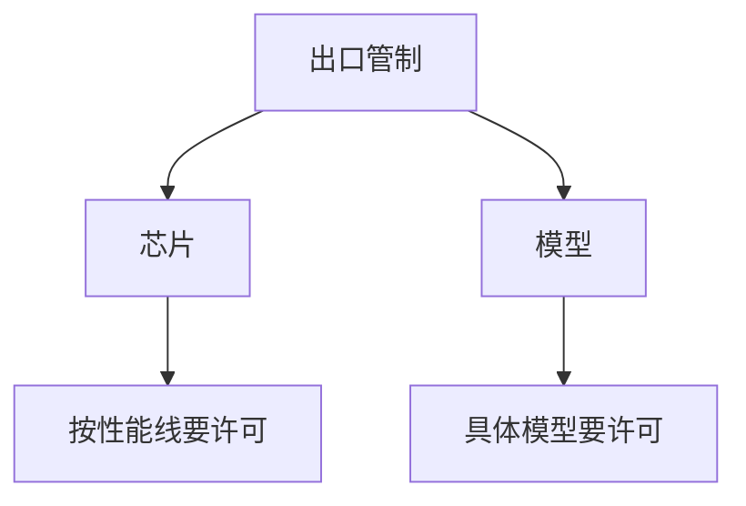

## Q
美国怎么管先进芯片和模型的出口？2026 年 6 月对 Fable 5 的那次限制，和芯片管制有什么不同？

## A
**出口管制有两个抓手：硬件（按性能线划定哪些芯片要许可）和模型（把一个具体模型的出口和访问纳入许可）；2026 年 6 月的 Fable 5 是后者，起因多半是一种越狱，而且谁在用都要验证国籍。**

| | 芯片 | 模型 |
|---|---|---|
| 例子 | 2026 年 1 月 15 日，美国商务部工业与安全局（BIS）规则：对华出口 H200 和 AMD MI325X 这一档，从"推定拒绝"改为逐案审查 | 2026 年 6 月 12 日，BIS 信函（商务部长 Lutnick 签署）要求出口、再出口、境内转让 Fable 5 和 Mythos 5 都要许可 |
| 条件 | 出货量不超过美国同款出货的 50%、在美国做第三方测试、核查客户，另有一道 25% 的关税；Blackwell B200 和下一代 Rubin 仍推定拒绝 | 许可要覆盖外国人，包括公司里的外籍员工；Anthropic 无法核实用户国籍，当天对所有用户停用 |
| 落地难点 | 北京也在限制进口，批不批是另一道门 | 法律依据未公开，分析人士对这种用在云接口上的管制有争议 |

**经过：** Fable 5 6 月 9 日发布；信函没有写明理由，Anthropic 的理解是政府认为有人演示了一种能解锁受限网络攻击能力的越狱；6 月 30 日限制解除，随后恢复，Mythos 5 只对部分美国机构开放，Anthropic 说已加新防护。

**新进展（2026 年 11 月）。** 前 OpenAI 研究员 Will DePue 发布"检查点取证"分析，称 Kimi K3、DeepSeek V4 等中国开放权重模型带有在 Blackwell 上训练的痕迹。这是单方的分析，尚未被独立验证；他自己也说这不等于违规，芯片可能在境外数据中心。

想一想：芯片在马来西亚的数据中心被中国公司租用，出口管制能管到吗？
管制管的是运往受限国家的货物，对在第三国租用算力基本管不到，所以才有人推动限制受限方远程使用云的法案（美国众议院已通过，尚未成为法律）。这也是芯片管制只能拖慢、很难堵死的原因。

