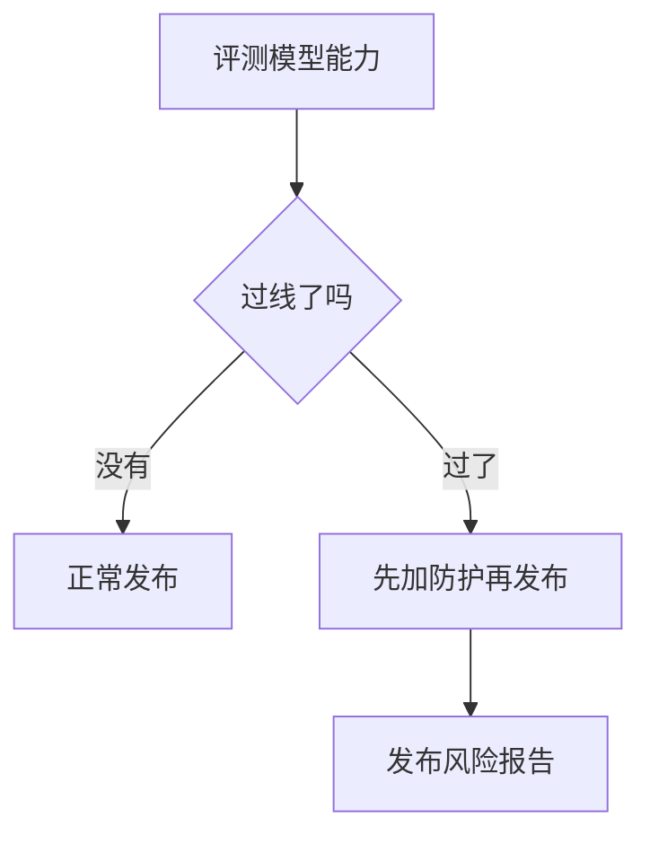

## Q
实验室自己定的"安全框架"是什么？为什么说它在 2026 年从自愿承诺变成了法律问题？

## A
**安全框架是一份预先写好的"如果模型的能力过了某条线，就必须先加某一级防护才能发布"的承诺；Anthropic 的负责任扩展政策（RSP）、OpenAI 的 Preparedness Framework、谷歌 DeepMind 的 Frontier Safety Framework 都是这个形状。**

| 实验室 | 做法 |
|---|---|
| Anthropic | 2025 年 5 月随 Claude Opus 4 启用 ASL-3（针对化学生物武器的分类器、访问控制、模型权重安全）。2026 年 2 月 24 日的 v3.0 整体重写：公开"前沿安全路线图"（不具约束力的目标）、每 3 到 6 个月发布风险报告（Risk Report），部分报告引入外部评审；"风险不可接受就暂停"的措辞被删掉。2026 年 7 月 8 日更新到 v3.4 |
| 谷歌 DeepMind | 以关键能力等级（CCL）为线；2025 年 9 月 22 日的 v3 加入"有害操纵"，2026 年 4 月 17 日的 v3.1 加入"追踪能力等级"，让较轻的风险更早被看到 |
| OpenAI | 按"高 / 严重"两级阈值分类，达到阈值前先要有对应的防护 |

**弱点：** 线是自己划的，评测是自己做的，涂黑哪些内容也是自己定的；很多条款是"别家也做我才做"的条件式承诺。

**新进展（2026 年 1 月）。** 加州 SB 53 生效（2025 年 9 月 29 日签署）：训练算力超过 10^26 次运算的开发者要发布安全框架；年收入超 5 亿美元的大型开发者要写明如何治理灾难性风险；不按自己公布的框架做就算违法，每次最高罚 100 万美元；严重安全事件 15 天内上报（有迫在眉睫的危险则 24 小时）。纽约的 RAISE 法 2027 年 1 月 1 日生效，上报窗口缩到 72 小时。

想一想：法律只要求"按自己公布的框架做"，不直接规定阈值，为什么？这样做的漏洞在哪？
危险能力的阈值科学上还没定论，法律先要求透明和自我约束，再看如何收紧。漏洞是公司可以把框架写松，所以真正的压力来自"违反自己公开的承诺可被起诉"，而不是框架的内容本身。

