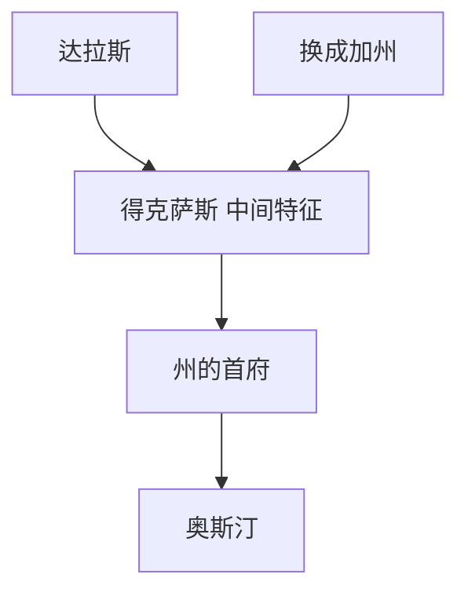

## Q
特征只说明"模型里有这个概念"。怎么知道一个回答是怎么一步步算出来的？这套方法现在能做到什么程度？

## A
**用归因图（attribution graph）：把一个具体回答涉及的特征画成一张图，边表示"哪个特征推动了哪个特征"，再用干预来验证——把图里的一个节点换掉，输出应当跟着变。**

**例子（Anthropic，2025 年 3 月，Claude 3.5 Haiku）：** 问"达拉斯所在州的首府是哪里"，图里先亮起"达拉斯在得克萨斯"这个中间特征，再到"奥斯汀"。把"得克萨斯"换成"加利福尼亚"，答案变成"萨克拉门托"。说明它在内部分两步走，而不是背下整句。

另一个例子：写押韵诗时，模型在写这一行之前就先选好行尾的韵脚词，再围绕它组织整行；改掉选定的词，整行跟着变。可见它不是严格地一个词接一个词。

| 方法 | 回答什么 | 代价 |
|---|---|---|
| 探针（probe） | 读激活，判断"这里有没有某个概念" | 便宜，可以大规模跑，但只说明相关 |
| 归因图 | 这个回答是怎么一步步算出来的 | 贵，一次只解释一个回答 |

**限制：** 即使很短的提示，也只抓到全部计算的一部分，工具本身还可能带来假象；对几十个词的提示，分析一张图要人花几个小时。所以现在是"挑一个有意思的回答做案例研究"，不是"检查每个回答"。

想一想：为什么要把"得克萨斯"换掉再看答案，而不是只看图？
图只是相关性的描述，可能是工具的假象；换掉一个节点后输出按预期改变，才说明这条路径真的在起作用。

