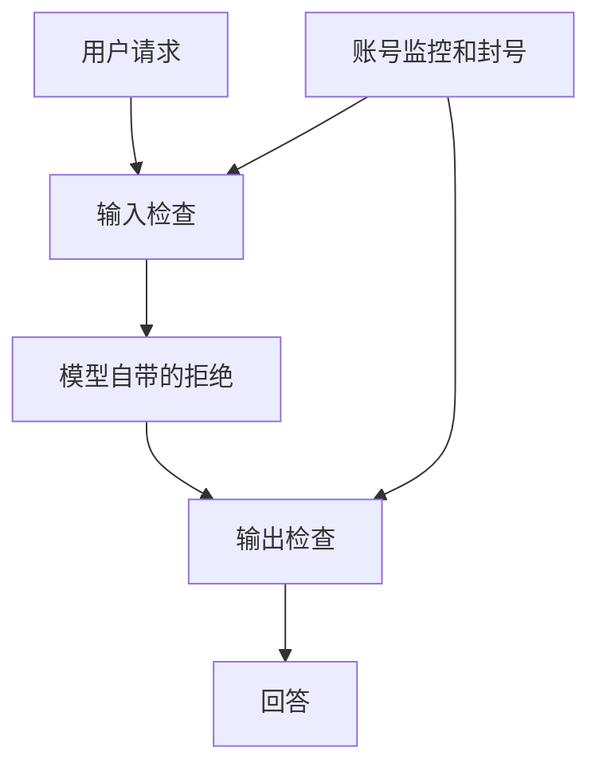

## Q
护栏（guardrail）有哪几层？Anthropic 的宪法分类器把越狱成功率降了多少，代价是什么，新一代又改了什么？

## A
**护栏是在模型之外再加的检查，一层挡不住就靠多层叠加；Anthropic 第一代宪法分类器把越狱成功率从 86% 压到 4.4%，代价是多花 23.7% 算力、多拒绝 0.38% 的正常请求。**

| | 第一代 | 下一代（2026 年 1 月） |
|---|---|---|
| 结构 | 输入、输出两个分类器各看各的 | 把输入和输出放在一起看；轻量的第一级筛全部流量，可疑的才交给第二级；再加读模型内部激活的探针（probe） |
| 额外算力 | 23.7% | 约 1% |
| 误拒正常请求 | +0.38% | 0.05% |
| 红队 | 赏金里出现过一个通用越狱 | 1,700 多小时、19.8 万次尝试，没有通用越狱，找到 1 个高危漏洞 |

**为什么要合在一起看：** 攻击者把有害内容拆成几段看似无害的话，或用代号描写化学品，分开看输入和输出都发现不了。

**另一种做法：** OpenAI 的开放权重模型 gpt-oss-safeguard（2025 年 10 月）让开发者在推理时直接给出自己的政策文本，模型按政策分类，改规则不用重训。

**新进展（2025 年 10 月）。** 一篇十四位作者的论文对 12 个已发表的越狱和注入防御发动"自适应攻击"（用梯度下降、强化学习、随机搜索和人工探索，针对防御本身改打法），多数成功率超过 90%，而这些防御原先报告的成功率接近 0。这是上表"红队"一行的反面：防御只对固定的攻击集测过。

想一想：为什么"在固定测试集上拦截率 100%"不能证明防御可靠？
攻击者会看着你的防御改打法，固定测试集里的攻击是别人在没见过这个防御时写的。可靠的证据是长时间、有激励的自适应红队，比如上面 1,700 小时的测试。

