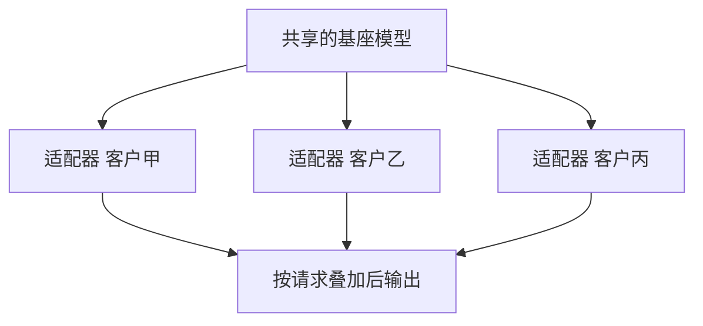

## Q
LoRA 微调出来的是什么？为什么一个基座模型能同时服务很多个定制版本？它的效果和全量微调比怎么样？

## A
**LoRA 冻结原模型，只在权重旁边训练一对很小的矩阵，产出一个几十到几百 MB 的"适配器"（adapter）；基座模型共享，每个请求按需叠加对应的适配器。**

- **为什么小：** 一个 4,096 × 4,096 的权重有约 1,677 万个数；秩（rank）为 8 的 LoRA 只训练 2 × 4,096 × 8 = 65,536 个数，约 0.39%。
- **为什么好用：** 7B 模型全量约 14 GB（FP16），一份适配器只有它的零头；推理引擎（如 vLLM）支持同一个基座同时挂多个适配器，一个客户一个。
- **和全量微调比：** 数据量中小时效果接近；数据特别大、要学很多新东西时，LoRA 容量不够，学得更慢。

**新进展（2025 年 9 月）。** Thinking Machines 与 John Schulman 发表《LoRA Without Regret》：在中小规模的指令数据上，对所有层（尤其是 MLP 层）用 LoRA，效果与全量微调相当；强化学习里，秩为 1 的 LoRA 就能追平全量微调；LoRA 最佳学习率约是全量微调的 10 倍。

想一想：为什么强化学习只需要容量很小的 LoRA？
强化学习每个回合只反馈约一比特的信息（成功还是失败），比监督学习逐 token 给标签的信息量少得多，所以很小的容量就足够装下它学到的东西。

