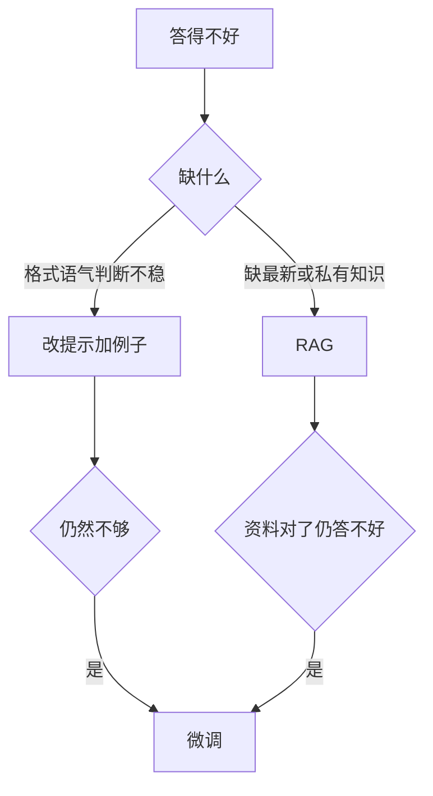

## Q
模型答得不好时，先改提示、做 RAG，还是微调（fine-tuning）？怎么判断缺的是知识还是行为？

## A
**缺知识用 RAG，缺行为（格式、语气、判断标准）先改提示再考虑微调：从最便宜、最容易撤回的手段开始往上走。**

| 手段 | 改变什么 | 成本和周期 | 撤回 |
|---|---|---|---|
| 改提示 | 输入的文字 | 分钟，几乎零成本 | 秒级 |
| RAG | 给模型的资料 | 天；向量库和检索 | 容易 |
| 微调 | 模型参数 | 周；数据、训练、评测 | 要重训；基座升级后要重做 |

**怎么判断：** 把正确资料直接贴进提示再问一次。答对了，缺的是知识，用 RAG；贴了资料仍然答得不稳、格式不对、风格不对，缺的是行为，先靠提示和例子，不够再微调。

**新进展（2026 年 5 月）。** OpenAI 开始收窄自助微调平台：2026 年 5 月 7 日起，从没微调过的组织不能再建微调任务；2027 年 1 月 6 日起，现有客户也不能再建新任务；已有的微调模型可以继续推理，直到它们的基座模型下线。

想一想：这个动向对你"要不要微调"的决定意味着什么？
说明前沿模型加提示加 RAG 已经能覆盖大多数原来要微调的场景；同时微调绑定某个基座，基座下线它就作废，所以真要微调，更多会转向可以自己控制的开放权重模型。

