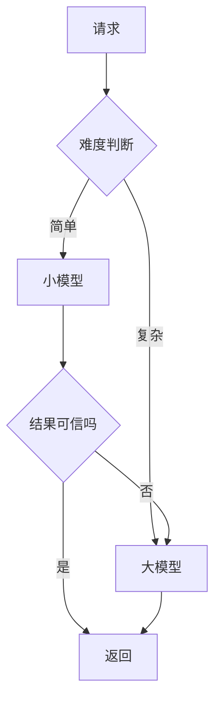

## Q
为什么说"简单请求交给小模型"是最直接的省钱办法？路由（routing）有哪几种做法？

## A
**同一家大小档位价差约 80 倍（Haiku 5.5 输入 0.10 美元，Fable 5.2 输入 8 美元，每百万 token），多数请求（分类、抽取、改写）小模型就够，只把难题升级给大模型。**

| 做法 | 怎么分 | 适合 |
|---|---|---|
| 规则路由 | 按任务类型、输入长度、用户等级 | 任务种类固定 |
| 分类器路由 | 先让小模型判断难度，再分流 | 请求类型很杂 |
| 级联（cascade） | 先用小模型，把握度低或校验失败再升级 | 能自动判断"答得好不好" |
| 顾问模式 | 小模型主跑，卡住时向大模型请教 | 大多数步骤简单、偶尔需要强推理 |

- **前提是评测：** 在带标签的测试集上，找出"小模型刚好达标"的那一档，不是凭感觉降级。
- **思考档位也是一种路由：** 同一个模型，把 effort 调低就是便宜的一档。

**新进展（2026 年 3 月）。** Anthropic 推出顾问工具（advisor tool，beta）：小模型（如 Haiku 5.5 或 Sonnet）当执行者，难点处由它自己调用 Opus 级模型当顾问。顾问的 token 按顾问的价格计费，单次输出通常 400–700 token，可以用 max_tokens 封顶。

想一想：为什么要给顾问的输出设上限？
顾问按大模型的单价计费，不设上限它会写出很长的分析；官方测试里把上限设为 2,048，顾问平均输出降到约七分之一，成本和延迟也随之降下来。

