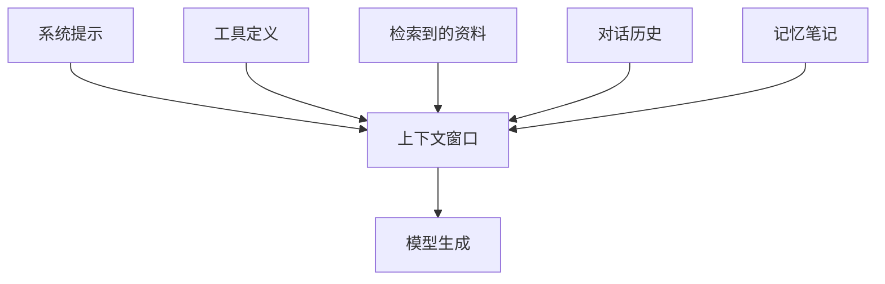

## Q
上下文工程（context engineering）是什么？它和"写提示词"有什么区别？

## A
**上下文工程 = 决定每一步让哪些信息进窗口，并把它们挑选、压缩、按需加载；目标是"让期望的结果最可能出现的、最小的一组高信息量 token"。**

- **提示词只是其中一块：** 提示工程管"这句话怎么写"，上下文工程管"窗口里整体放什么"。
- **为什么更多不等于更好：** 注意力里每个新 token 都要和所有 token 比较，token 越多，每个能分到的关注越少（Anthropic 叫它"注意力预算"）。
- **按需加载（just-in-time）：** 智能体不必把所有文件读进来，只保留文件路径这类轻量索引，用到时再用工具读；折中做法是项目说明文件（如 CLAUDE.md）一开始就载入，其余边探索边读。
- **你在 Claude Code 里看到的：** 它先读 CLAUDE.md，再用搜索和读文件工具一点点补充，而不是把整个仓库塞进去。

**新进展（2025 年 9 月）。** Anthropic 发表《AI 智能体的有效上下文工程》，把这个词定位成"提示工程的自然演进"，核心原则是"做最简单、能奏效的事"。此后业界从"写好一句提示"转向设计整个窗口。

想一想：把 100 个文件全读进窗口，和先读目录再按需读几个文件，各自的代价是什么？
全读：每步都付全部 token 的钱，并让注意力被稀释；按需读：多几次工具调用的往返，但每步窗口小而准。

