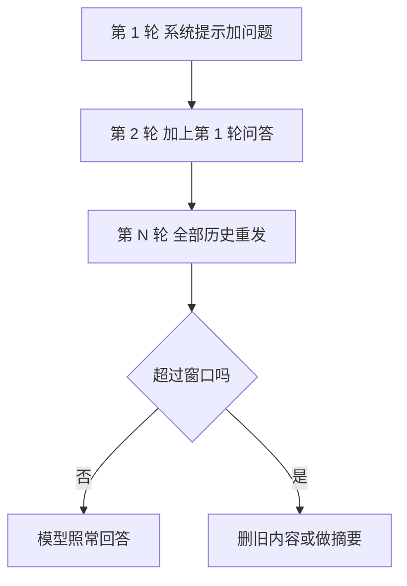

## Q
大模型"记得"之前聊过的内容吗？上下文窗口（context window）到底是什么？

## A
**模型自己没有记忆：每次请求，应用把整段对话重新发一遍，模型只看得到这一次窗口里的 token。**

- **窗口：** 一次请求里"输入 + 输出（含思考）"的 token 总上限，是模型的工作台，和训练数据无关。
- **聊天应用做的事：** 每轮把历史追加在后面，整体再发一次。

```text
第 1 轮发送：[系统提示] [我：我叫小王]
第 2 轮发送：[系统提示] [我：我叫小王] [AI：你好小王]
             [我：我叫什么？]
```

- **"忘了"的真相：** 旧内容被删掉或被摘要替换后不再发送，模型就真的看不到了。
- **超出窗口：** 输入本身超过上限，接口直接报错（Claude 接口返回 400，提示 "prompt is too long"）。发送前可以用 token 计数接口先估算。


