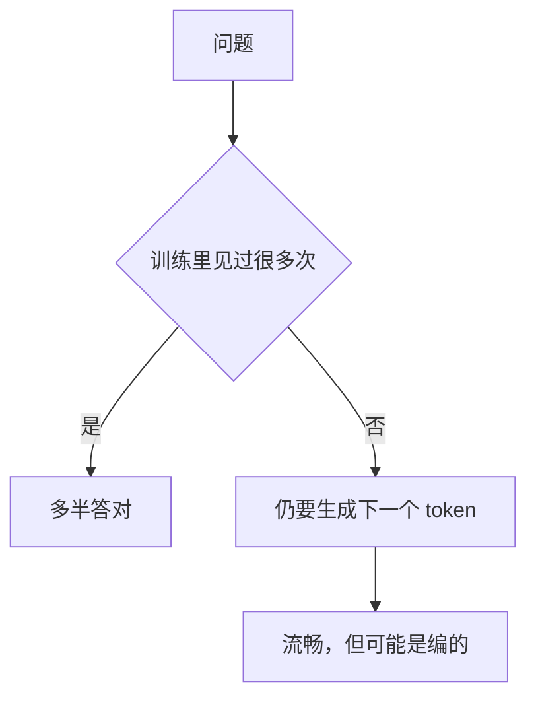

## Q
大模型为什么会一本正经地编造（幻觉，hallucination）？根子在哪里？

## A
**模型每一步输出的是"最可能的下一个 token"，不是从数据库里查到的事实；它不知道时，最顺口的续写依旧是一个自信的答案。**

- **预训练的原因：** 学到的是文字的统计规律。常见事实重复出现，有规律可学；只出现一两次的冷门事实（某个人的生日）没有规律，只能猜。OpenAI 的论文估计：预训练后的幻觉率，至少是训练数据里"只出现过一次的事实"所占的比例。
- **评测和训练的原因：** 多数榜单只算对错，"我不知道"得 0 分、猜一个有可能得分，模型被养成了"好的应试者"，宁可猜也不弃权。

**新进展（2025 年 9 月）。** OpenAI 发表《语言模型为什么会幻觉》，把一部分责任归给评测方式。他们的例子（SimpleQA）：gpt-5-thinking-mini 弃权 52%、答错 26%；o4-mini 弃权 1%、答错 75%，而准确率差不多（约 22% 对 24%）。建议榜单对"自信答错"扣分，对"承认不确定"给部分分。

想一想：如果一个榜单只看准确率，模型想拿高分应该怎么做？这对你选模型意味着什么？
应该永远猜、从不弃权；所以只看准确率会奖励敢乱答的模型，选模型时还要看它答错的比例和会不会说不知道。

