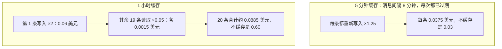

## Q
**挑战。** 你的智能体有 1.5 万 token 的系统提示（规则加工具），用 Sonnet 5.5（每百万输入 2 美元；5 分钟缓存写入 ×1.25，1 小时写入 ×2，读取 ×0.05）。用户是真人，平均每 8 分钟发一条消息，一次会话约 20 条。团队开了默认的 5 分钟缓存，反而觉得账单变贵了。解释原因，并给出配置和估算。

## A
**评分点（答出 3 条算过）：**

1. 原因：消息间隔 8 分钟超过 5 分钟有效期，缓存每次都已过期，每条消息都重新写入，写入价 ×1.25 比不缓存还贵。
2. 对不缓存的估算：每条 1.5 万 × 2 美元每百万 = 0.03 美元；5 分钟缓存每条变成 0.0375 美元。
3. 修法：改用 1 小时缓存（写入 ×2，读取 ×0.05）；之后每条只付读取。
4. 估算：首次写入 1.5 万 × 4 美元每百万 = 0.06 美元，其余 19 条各 1.5 万 × 0.10 美元每百万 = 0.0015 美元，20 条合计约 0.0885 美元，不缓存是 0.60 美元。
5. 顺带检查：把时间戳之类每次都变的内容移出前缀，保证读取不被破坏。

参考答案
用户每 8 分钟才发一条，超过 5 分钟的有效期，缓存每次都过期，于是每条消息都要重新写入缓存，付 1.25 倍价，比不缓存的 0.03 美元还贵，变成约 0.0375 美元。应该改用 1 小时缓存：第一条写入付 2 倍价，约 0.06 美元，后面 19 条只付读取价，每条约 0.0015 美元，20 条合计约 0.0885 美元，对比不缓存的 0.60 美元省了约 85%。同时确认前缀里没有时间戳之类每次变化的内容，否则读取仍然会失败。

