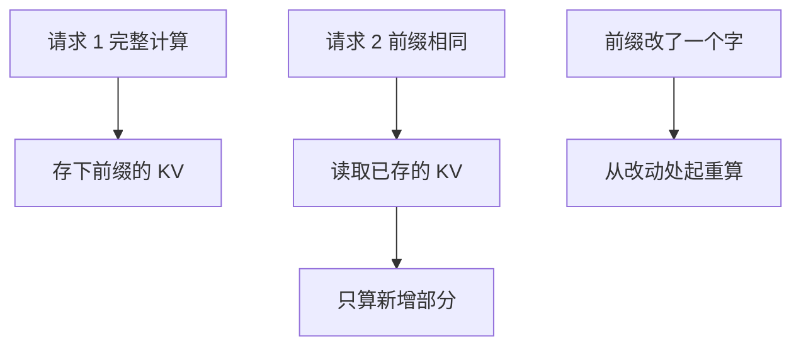

## Q
提示缓存（prompt caching）是怎么省钱的？它和你学过的 KV 缓存是什么关系？

## A
**命中缓存的那段前缀不用重新计算：服务端把这段前缀的 KV 缓存（每个 token 在每层的 K、V 向量）存起来，下次请求开头一字不差，就直接读出来，只算新增的部分。**

- **为什么前缀能复用：** 注意力里每个位置只看它前面的内容，所以一段前缀的 K、V 和后面接什么无关；前面一个字变了，从那里往后全部要重算。
- **前缀的顺序：** 工具定义 → 系统提示 → 对话消息；在哪一层改动，那一层和后面的缓存都失效。
- **价格（Claude）：** 写入缓存比普通输入贵（5 分钟有效期 ×1.25，1 小时 ×2），读取只要基础输入价的 10%；Opus 5.5、Sonnet 5.5 降到 5%，Fable 5.2 降到 2.5%。



```python
client.messages.create(
    model="claude-sonnet-5-5",
    cache_control={"type": "ephemeral"},  # 自动缓存
    system=LONG_SYSTEM_PROMPT,
    messages=history)
```

**新进展（2026 年 9 月）。** Opus 5.5、Sonnet 5.5 把缓存读取价压到基础输入价的 5%（此前是 10%），Fable 5.2 压到 2.5%。Sonnet 5.5 每百万 token：未命中 2 美元，命中 0.10 美元。

<details class="pt"><summary>想一想：一份 20 万 token 的固定手册，5 分钟内连续问 100 次，Sonnet 5.5 的输入成本约是多少？不缓存呢？</summary>首次写入约 0.50 美元（20 万 token 按 2.5 美元每百万），之后 99 次读取各 0.02 美元，合计约 2.5 美元；不缓存每次 0.40 美元，共 40 美元，约 16 倍。</details>
