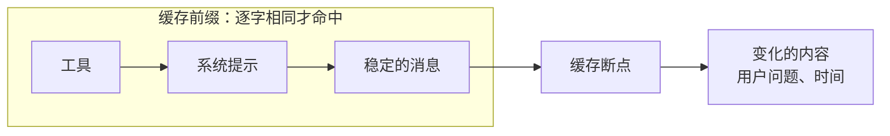

## Q
你开启了提示缓存，账单却没降。缓存为什么没命中？怎么排查？

## A
**缓存只认"逐字相同的前缀"：前缀里只要有每次都在变的东西，它后面的内容就全部失效。**



| 原因 | 例子 | 修法 |
|---|---|---|
| 变量在前面 | 系统提示第一行写"当前时间：…" | 把变化的内容移到消息末尾 |
| 前缀太短 | 低于最小长度（512–4,096 token，依模型而定），不缓存，也不报错 | 合并稳定内容，或不指望缓存 |
| 改了工具 | 工具顺序或描述变了，工具、系统、消息三层缓存全失效 | 固定工具列表和顺序 |
| 间隔太长 | 默认只保留 5 分钟（每次命中会刷新） | 用 1 小时有效期，或接受 |
| 并发太早 | 缓存要等第一个请求开始响应后才能被读到 | 先发一个，再并发发其余 |
| 断点放错 | 缓存标记打在含时间戳的块上，永远不命中 | 打在最后一个"每次都一样"的块上 |

**怎么看：** 响应的 usage 里有三个数：cache_creation_input_tokens（本次写入）、cache_read_input_tokens（本次读取）、input_tokens（断点之后没缓存的部分）；前两个都是 0，说明根本没缓存。

```json
"usage": {"cache_creation_input_tokens": 0,
          "cache_read_input_tokens": 18432,
          "input_tokens": 212}
```

**经验：** 稳定的放前面（工具、规则、文档），变化的放后面（用户问题、时间）。
