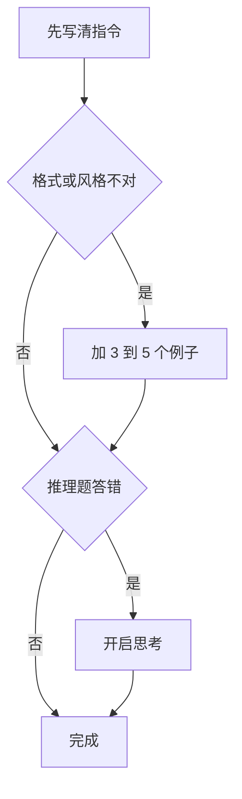

## Q
少样本提示（few-shot）是什么？给几个例子合适？它和只写指令、和微调相比各有什么位置？

## A
**少样本 = 在提示里放几组"输入 → 理想输出"，模型照着例子的格式、语气和判断边界续写；Anthropic 建议放 3–5 个、彼此不同的例子。**

```text
把工单归类，只输出类别。
工单：被扣了两次款
类别：重复扣款

工单：收不到验证码
类别：登录问题

工单：{新工单}
类别：
```

| 方法 | 给模型什么 | 适合 |
|---|---|---|
| 零样本 | 只有指令 | 任务一句话讲得清 |
| 少样本 | 指令 + 3–5 例 | 格式、语气、边界难用话说清 |
| 微调 | 成百上千例并改参数 | 例子多到提示装不下，或要稳定风格 |

- **例子要多样：** 全是同一类别，模型会偏向那一类；要放进容易混淆的边界例子。
- **和指令隔开：** 用 `<example>` 标签包起来，免得被当成指令。



**新进展（2026 年 11 月）。** 按 Claude 当前的官方文档，例子对"会思考的模型"依然有效：例子会影响模型在思考过程里解题的方式，所以示例最好写成"问题、使用的方法、期望答案"三段，而不只是输入输出。

<details class="pt"><summary>想一想：为什么给会思考的模型写例子时，要把"使用的方法"也写出来？</summary>模型会模仿例子里的推理路径，只给最终答案，它学到的是答案的格式；写出方法，它学到的是怎样想。</details>
