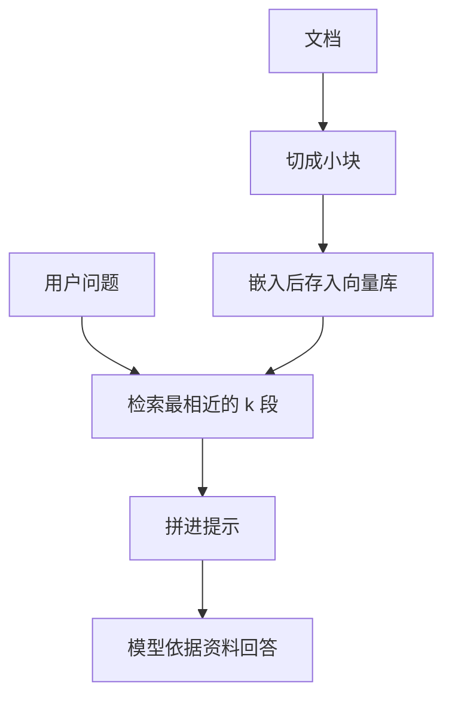

## Q
检索增强生成（RAG，retrieval-augmented generation）是怎么工作的？为什么需要它？

## A
**RAG = 先用问题去资料库检索出最相关的几段，拼进提示，让模型"开卷作答"，而不是凭训练时的记忆。**



- **离线：** 文档切块，每块算一个向量（嵌入）存进向量库。
- **在线：** 问题也算向量，取最相近的 k 块，连同问题一起交给模型。

```text
<资料>
[1] 退款：购买后 7 天内原路退回……
[2] 虚拟商品开通后不支持退款……
</资料>
只依据资料回答，并标注编号。问题：开通会员后能退款吗？
```

**为什么需要：** 模型不知道你的私有数据，也不知道训练截止之后的事；资料放在库里，更新文档就行，不用重新训练；答案有出处，可以核对，也能压低幻觉。
