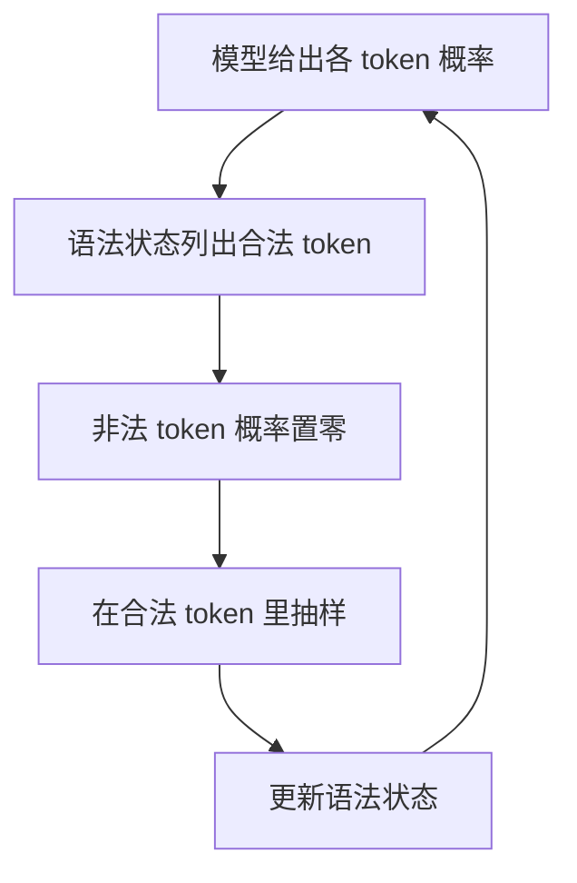

## Q
怎样保证模型输出的一定是合法的 JSON？受约束解码（constrained decoding）是怎么做到的？

## A
**每一步生成时，把 schema（描述 JSON 结构的规则）编译成语法，只允许"仍然能走到合法 JSON"的 token 参与抽样；其余 token 的概率直接置零。**



**例子：** schema 要求 {"age": 整数}。已生成 `{"age": ` 之后，下一个 token 只能是数字（或空格），字母、引号都被屏蔽，所以不会出现 "twenty"。

三个层次：

| 层次 | 保证什么 |
|---|---|
| 提示里写"请输出 JSON" | 只是请求，偶尔会多一句"好的，下面是 JSON" |
| JSON 模式 | 保证是合法 JSON，字段和类型不保证 |
| schema 约束 / 严格工具调用 | 保证字段齐全、类型和枚举正确 |

```json
"output_config": {"format": {"type": "json_schema",
  "schema": {"type": "object",
    "properties": {"category": {"enum": ["退款","账号","物流"]}},
    "required": ["category"],
    "additionalProperties": false}}}
```

**新进展（2026 年 2 月）。** Claude 4.6 起，用"预填助手回复的开头（如先写一个左花括号）"逼出 JSON 的老办法不再支持，请求会返回 400；官方改建议用结构化输出或明确的指令。

<details class="pt"><summary>想一想：预填 "{" 为什么不能保证输出合法，而约束解码可以？</summary>预填只固定了开头，后面每个 token 仍自由抽样，可能漏引号或多字段；约束解码在每一步都过滤掉非法 token，所以整段都合法。</details>
