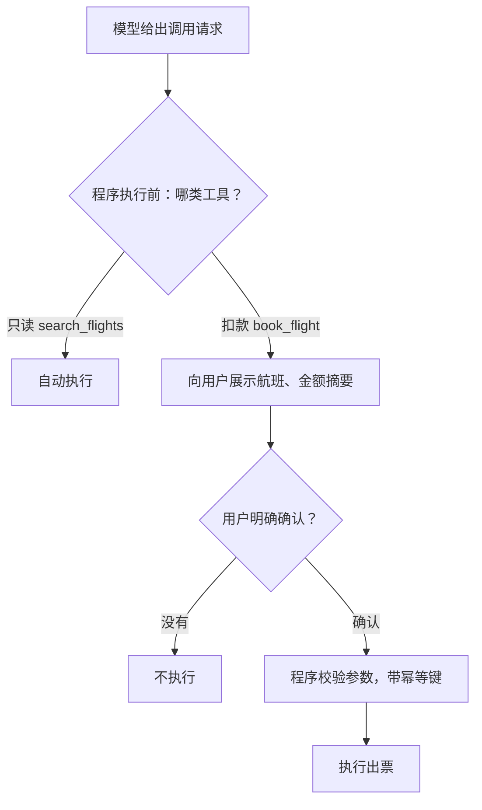

## Q
**挑战。** 你做订机票助手，有两个工具：search_flights（只读搜索）和 book_flight（扣款出票，不可撤销）。测试发现：用户还在比价说"这个看起来不错"，模型就调用了 book_flight。你怎么设计，才不会让模型"手快"扣款？

## A
**评分点（答出 3 条算过）：**

1. 抓住机制：模型只给出调用请求，执行在你的程序里，所以可以在执行前拦截。
2. 把工具分级：只读工具自动执行；写入、扣款类工具先向用户展示摘要，等明确确认再执行。
3. 工具描述写明前置条件，如"仅在用户明确说确认订购后调用"，并用参数（如 confirmed 标志）让校验可检查。
4. 程序侧校验参数：金额、航班号、用户身份从会话取，不信任模型填的值；用幂等键避免重复出票。
5. 用测试集覆盖"含糊表态"（"看起来不错"），监控并记录每次调用供审计。

参考答案
模型输出的只是调用请求，真正扣款在你的程序里，所以应该在执行前加一道闸：只读工具自动放行，扣款工具先把航班、金额摘要给用户看，等明确的确认再执行。工具描述里写清前置条件，程序再校验参数，金额和身份从会话里取，不采信模型填的值，并用幂等键防止重复出票。最后用含糊表态的对话做回归测试，并记录每次调用以便审计。

