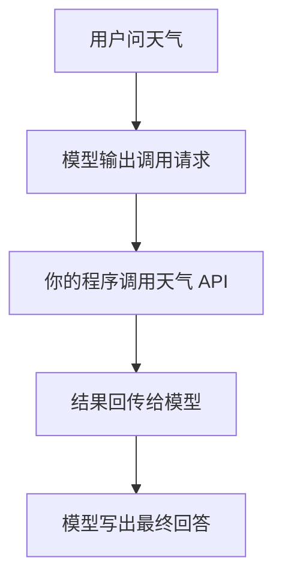

## Q
模型只会输出文字，工具调用（function calling）怎样让它"动手"？一轮完整的往返长什么样？

## A
**模型只输出一个结构化的"调用请求"（工具名 + 参数）；真正执行的是你的程序，结果再作为新消息交回模型，由它写最终回答。**



```json
// 请求里声明工具：名字、描述、参数的格式
{"name": "get_weather",
 "description": "查询城市当前天气",
 "input_schema": {"type": "object",
   "properties": {"city": {"type": "string"}},
   "required": ["city"]}}
// 模型的回复（stop_reason 为 tool_use）
{"type": "tool_use", "id": "toolu_01",
 "name": "get_weather", "input": {"city": "旧金山"}}
```

- **模型凭什么选工具：** 只凭名字和描述，描述就是写给模型的提示词。
- **模型不执行任何代码：** 参数对不对、能不能执行，由你的程序把关。

**新进展（2025 年 12 月）。** Anthropic 把模型上下文协议（MCP，Model Context Protocol，给模型接外部工具的统一标准）捐给 Linux 基金会旗下新成立的 Agentic AI Foundation，OpenAI、Block 共同参与；基金会称已有一万多个 MCP 服务器。工具的"名字 + 描述 + 参数格式"统一以后，一个工具服务器可以接 Claude、ChatGPT、Gemini 等多个客户端。

<details class="pt"><summary>想一想：为什么协议统一后，一个工具服务器可以同时给不同厂商的模型用？</summary>对模型来说工具只是一段"名字、描述、参数格式"，调用和结果也是固定格式的消息；只要各家客户端都按同一协议列出工具、转发调用，服务器就不必为每家重写。</details>
