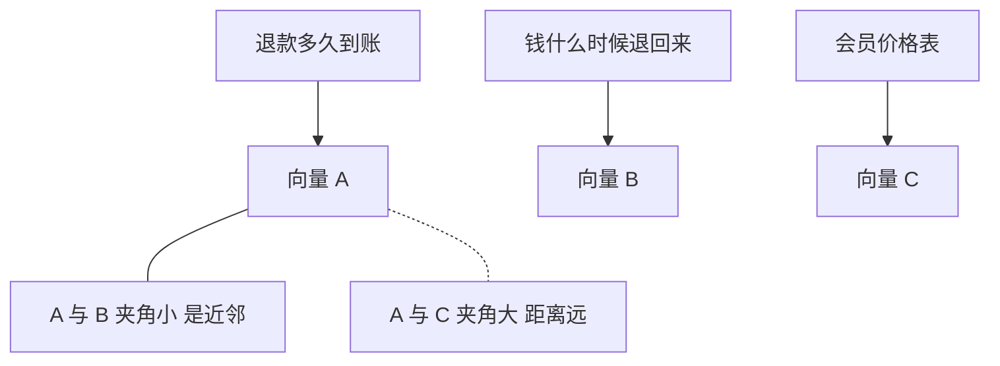

## Q
嵌入模型（embedding model）怎样把"意思相近"变成"距离相近"？语义检索（semantic search）是怎么用它找资料的？

## A
**嵌入模型把一整段文字压成一个固定长度的向量（如 1,024 或 3,072 个数），训练目标是让意思相近的文字向量方向相近；检索就是把问题也变成向量，找夹角最小的文档向量。**

- **入库：** 每块文字过一次嵌入模型，向量存进向量库。
- **查询：** 问题过同一个模型，用余弦相似度（cosine similarity，两个向量夹角的余弦，越接近 1 越相似）找 top-k。
- **和你学过的 token 嵌入的区别：** token 嵌入是一个 token 对应一个向量（模型内部用）；嵌入模型输出的是整段文字一个向量，专门拿来比较和检索。
- **关键词搜索对不上的地方：** "退款多久到账"和"钱什么时候退回来"没有一个共同的词，向量依然很近。

**新进展（2026 年 3 月）。** Google 发布 Gemini Embedding 2，称是第一个原生多模态嵌入模型：文字、图片、视频、音频和 PDF 映射进同一个向量空间；输出 128 到 3,072 维（推荐 768、1,536、3,072），输入上限 8,192 token。

想一想：文字和图片在同一个向量空间里，能做成什么以前做不到的检索？
可以直接用一句文字去搜图片或视频片段：查询向量和图片向量放在同一空间里直接比距离，不必先给每张图片生成文字描述。

