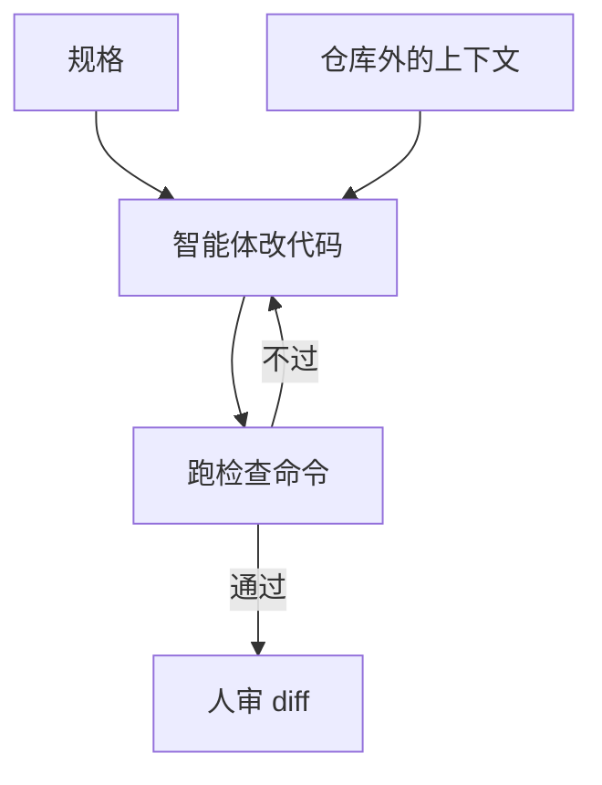

## Q
让编程智能体写代码，人的工作变成了什么？同一件事怎么交代，才不用来回返工？

## A
**人的工作变成三件：写清规格、只补它看不到的上下文、给它一条会报对错的检查。**

| 含糊 | 具体 |
|---|---|
| 修一下登录的 bug | 用户反馈会话超时后登录失败。看 src/auth/ 里的 token 刷新，先写一个能复现的失败测试，再修 |

- **规格：** 点名文件，写现象，说明"修好"长什么样。
- **上下文：** 只写仓库里读不出来的：会议上定的决定、只在某人脑子里的部署流程、测试要先设的环境变量。能从代码读出来的不写，写多了反而稀释注意力。
- **检查：** 一条返回通过或失败的命令（测试、类型检查、linter）。记忆文件里最有用的一行，就是跑它的命令。

**新进展（2026 年 11 月）。** Claude Code 官方最佳实践页写明：它读代码就能知道文件布局、约定和测试框架，所以只该补它读不出的东西；同时专门列出"现在可以不再做的事"。默认越做越多，人要给的就越集中在决定、规格和检查。

想一想：默认越来越聪明以后，哪类信息永远只能由你给？
仓库里没有的信息：团队会上做的决定、你对两种合理做法的偏好、必须通过的验收标准。这些读代码读不出来，只有人知道。

