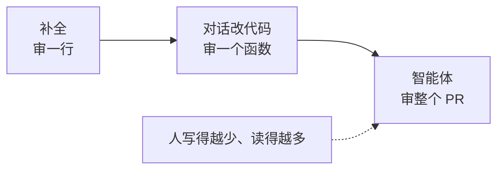

## Q
补全、对话改代码、让智能体独立改，三种用法差在哪？人的时间各花在哪里？

## A
**越往下，人写得越少、读得越多：补全你逐行把关，智能体你只在最后审整个 diff。**

| 用法 | 谁握着循环 | 人做什么 | 审查单位 |
|---|---|---|---|
| 补全 | 人 | 写，按 Tab 接受 | 一行 |
| 对话改代码 | 人和模型轮流 | 描述，看改动 | 一个函数 |
| 智能体 | 模型 | 写规格，审 diff | 整个 PR |

- **审查成本随 diff 增大而陡增：** 一个任务一个 PR，越小越好审；大改动先让它列计划，你批完再动手。
- **适合交出去：** 有测试可验证的缺陷修复、机械迁移、补测试、一次性脚本、读陌生代码库并回答问题。
- **留在自己手里：** 目标模糊的架构决定、安全关键代码、没有任何验证办法的事。
- **并行：** 几个智能体各改不同任务，各自在隔离的工作目录里，你轮流审。

判断标准是三问：**能自动验证吗？改错了能撤回吗？关键上下文在不在我脑子里？**

想一想：为什么"能自动验证"比"任务难不难"更决定该不该交给智能体？
难但可验证的任务，智能体会靠检查反复试到对。简单但无法验证的任务，错了你也看不出来，只能自己逐行读，省不下时间。

