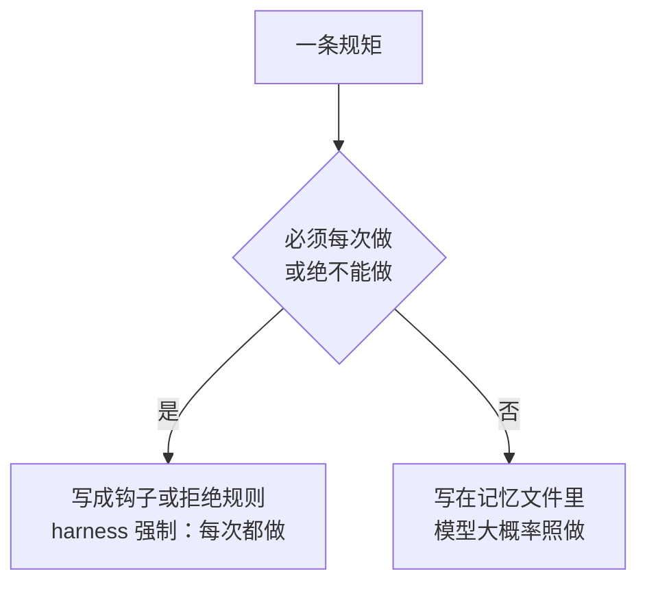

## Q
一个 600 行的智能体 PR，评审人 4 分钟就批了，两周后线上出事。这类代码常见哪几种"看起来对"的错？怎么防？

## A
**智能体的错读起来都很顺，错在没人验证的地方；防线是检查、小 diff 和强制规则，不是读得更仔细。**

| 常见错 | 防线 |
|---|---|
| 调用不存在的接口或包名，读起来很自然 | 编译、类型检查、运行测试 |
| 不用仓库里已有的工具函数，另造一套 | 记忆文件里写明约定；评审时问"有现成的吗" |
| 过度设计：多余的抽象、测不到的分支 | 让评审只对照规格，并要求"不管风格"；要求找问题的评审一定会找到点什么 |
| 必须每次做或绝不能做的事被漏掉 | 写成钩子（hook）或拒绝规则，由 harness 强制 |
| 你自己越来越看不懂这段代码 | 让它解释，自己改一处小的 |

要点：同一行规矩加粗加大写还是被忽略，就该写成钩子；模型是"大概率照做"，钩子是"每次都做"。

**新进展（2026 年 1 月）。** Anthropic 做了一个对照实验：52 名主要是初级的工程师学一个新的 Python 库，用 AI 的一组随后测验平均约 50%，手写组约 67%，做题用时没有显著差别（约 23 分钟对 25 分钟）。差距最大的是调试题；把代码生成和调试全交给 AI 的人分最低，拿 AI 问概念的人分更高。

想一想：为什么两组一样快，差距却出在调试题上？
手写组自己撞上更多报错、自己修，练的正是调试。AI 组少了这些练习，所以到了需要判断"代码错在哪"时就吃亏。

