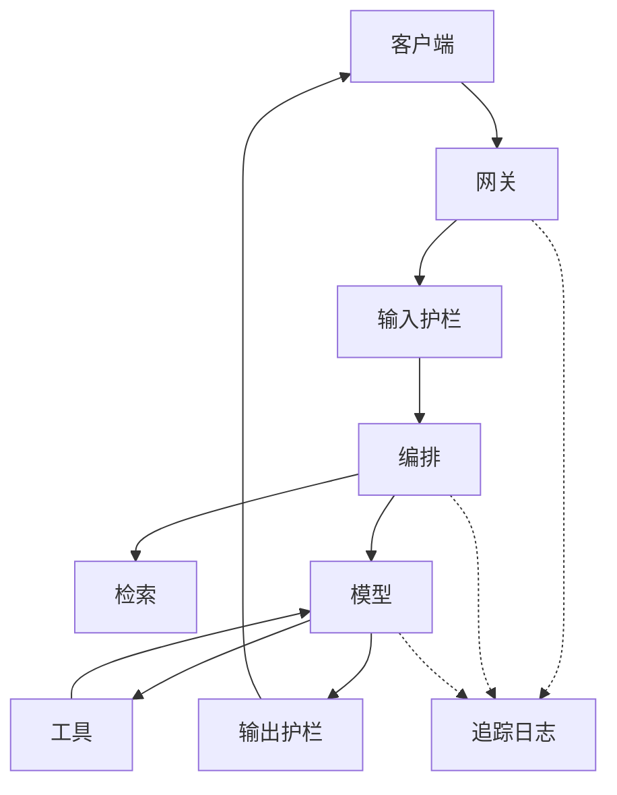

## Q
一个带大模型的功能，用户的一次请求在后端要经过哪几层？每层管什么？

## A
**一次请求依次过网关、输入护栏、编排（拼提示、检索、调工具）、模型、输出护栏；记录系统在旁边全程录像。**

以"员工问年假天数"的机器人为例：

| 层 | 做什么 |
|---|---|
| 网关 | 鉴权、限流、预算，选模型，失败时换模型 |
| 输入护栏 | 拦提示注入，遮住身份证号这类敏感信息 |
| 编排 | 拼提示：系统提示加检索到的制度加对话历史 |
| 检索 | 按员工身份过滤后找相关条款 |
| 输出护栏 | 校验答案带出处、格式合法、没泄漏敏感信息 |
| 追踪 | 每步的输入、token、耗时、版本 |

**其中真正"聪明"的只有模型那一步，其余各层是确定性的工程。**

