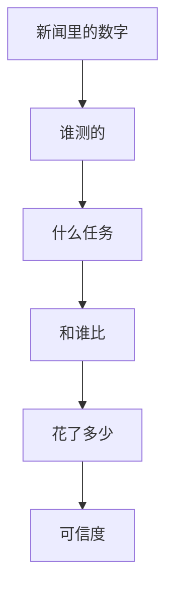

## Q
看到一条"新模型在某基准上超过人类"的 AI 新闻，先问哪几个问题，才知道这个数字能信几成？

## A
**先问四件事：谁测的、在什么任务上、和谁比、花了多少；答不上来的数字先当广告。**

| 问 | 为什么要问 | 例子 |
|---|---|---|
| 谁测的 | 厂商自报用自己调好的设定 | 同一基准 SWE-bench Pro，Scale 最初的分析里 Claude Opus 4.1 在公开集 22.7%，私有集 17.8% |
| 什么任务 | 基准的任务不等于你的任务 | 修开源 Python 仓库的 issue，不等于改你们的内部系统 |
| 和谁比 | 对照是上一代、同设定的别家、还是人？ | "超过人类"要看人是谁、给了多少时间 |
| 花了多少 | 分数常随花的钱涨 | 同一模型低档 35 分、每任务 0.98 美元，最高档 58 分、10.04 美元 |

后一行是 Artificial Analysis 在 2026 年 10 月对 Claude Opus 5.5 的测量。

想一想：为什么"花了多少"该和分数一起报？
分数可以靠多想一会儿、多试几次换来。不带成本的分数，等于只报了收入不报花费，没法判断是更强的模型还是更贵的用法。

