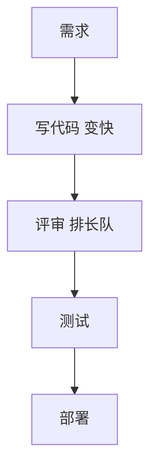

## Q
写代码变快以后，软件团队的瓶颈会在哪里？乐观和悲观两派各拿什么论据？

## A
**写代码变快后，瓶颈搬到评审、测试和部署；乐观派赌软件需求会涨，悲观派赌岗位和技能会缩。**

| 乐观派 | 悲观派 |
|---|---|
| 软件变便宜，需求会变多（需求弹性） | 入门级岗位先收紧，培养链条变薄 |
| 工程师的工作转向定义问题和验证 | 过度依赖 AI 会削弱调试能力 |
| 软件岗位发布量 2025 年中触底后回升 | 吞吐量涨了，稳定性变差 |

**新进展（2025 年 9 月）。** 谷歌 DORA 的年度调查（约 5,000 名技术人员）发现 AI 采用率达到约 90%，且这次 AI 与软件交付吞吐量正相关，但稳定性问题依然存在。报告的结论是 AI 是"放大器"：放大强团队的长处，也放大弱团队的弱点。

想一想：如果 AI 是放大器，同一个工具给强团队和弱团队，差距会变大还是变小？
会变大。强团队有测试、评审和发布流程，把更快的写代码转化成更多可靠的交付；弱团队没有这些，只是更快地产生更多没人验证的代码。

