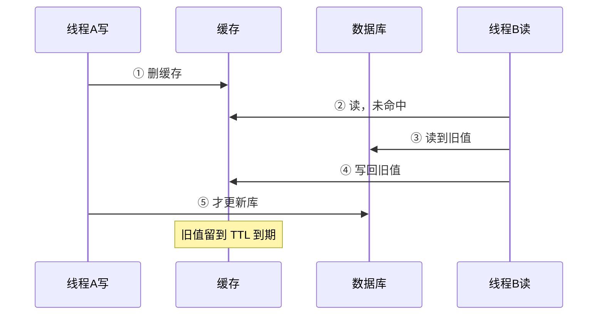
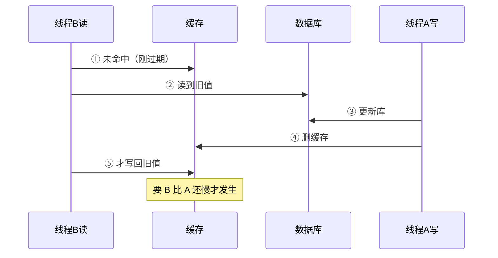

## Q
**缓存一致性 · 先更库再删缓存，还是先删缓存**｜必会

面试官：「先更新数据库再删缓存，和先删缓存再更新数据库，哪个更好？为什么？」

## A
**基本回答。** 先更新数据库再删缓存更好，不一致的窗口最小；但它仍然不是强一致：更新库和删缓存是两步，不是原子的，删除之前读者仍读到旧缓存，删缓存也可能失败，读慢于写的极端并发还是会写回旧值。所以只是窗口最小的最终一致，靠 TTL 兜底、失败重试或订阅 binlog 补删。
**先看图。**
先删缓存的危险时序（线程 A 在写，线程 B 在读）：

A 删了缓存，但还没更新库，B 正好读库拿到旧值，写回缓存；A 之后才更新库，缓存里就一直是旧值。再看先更库的时序，旧值要写回，B 必须比 A 慢：

**容易错。**
- **以为先删缓存更干净：** 先删之后读库写回旧值的窗口，就是整个库更新时间。
- **以为先更库再删就是强一致：** 它仍有极低概率的旧值回写，只是窗口最小的最终一致。
- **忽略删除可能失败：** 删缓存失败会留下旧值，要靠重试、消息队列和 TTL 兜底。
- **把窗口和概率说反：** 先删缓存窗口大、概率高；先更库要求读慢于写，概率很低。

