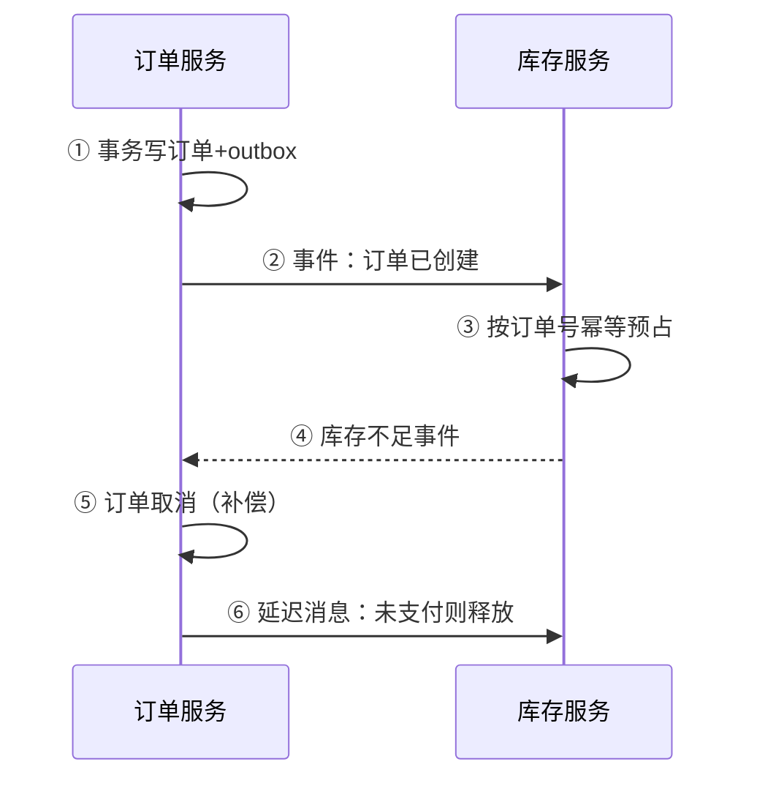

## Q
**最终一致 · 订单服务和库存服务怎么保持一致**｜必会

面试官：「订单服务和库存服务各有自己的库。用户下单要扣库存，你怎么让两边最终一致？库存不足、支付超时又怎么处理？」

## A
**基本回答。** 订单服务本地事务里写订单（待支付）和 outbox 事件，库存服务消费事件并按订单号幂等地预占库存。预占失败就回发「库存不足」事件，订单据此取消（Saga 补偿）。支付超时用延迟消息触发取消，库存释放同样按订单号幂等。 预占用 `UPDATE ... WHERE n > 0` 条件更新防超卖；事件至少一次，所以取消也按订单号幂等。
**先看图。**

订单服务把订单和事件在同一个事务里写好，库存服务异步预占；预占失败就回发事件让订单取消；下单时发出的延迟消息到点后，未支付则取消订单并释放库存。
**举个例子。** 某商品库存 n=1，订单 O1、O2 同时下单：
1. **O1 先到：** 执行条件更新，库存 1 > 0，成功，n 变 0，影响 1 行，预占成功。
2. **O2 后到：** 库存已是 0，`n > 0` 不成立，影响 0 行，预占失败，库存服务回发「库存不足」，订单服务把 O2 取消。
3. **O1 一直不付款：** 延迟消息到点，订单服务发现还是待支付，取消订单并发释放事件，库存服务把 n 加回 1，并按订单号 O1 记一笔已释放。
4. **重复释放：** 同一条释放事件又来一次，按订单号已处理，不再加回，n 保持 1。
5. **乱序：** 如果订单 O3 的释放事件比预占事件先到，库存服务记下「O3 已释放」；稍后 O3 的预占到达，查到已释放，直接忽略，库存不会被永久占住。
**容易错。**
- **先读库存再扣减：** 两个请求都读到 1，都扣，超卖；要用条件更新让数据库来判断。
- **预占、释放不用订单号做幂等键：** 事件至少一次，重复到达会重复占用或重复放回。
- **只处理「预占后释放」：** 乱序时释放先到，后到的预占会把库存永久占住，要记录已释放。
- **以为下单后库存就扣了：** 预占只是占住，付款确认前随时会因超时释放。
