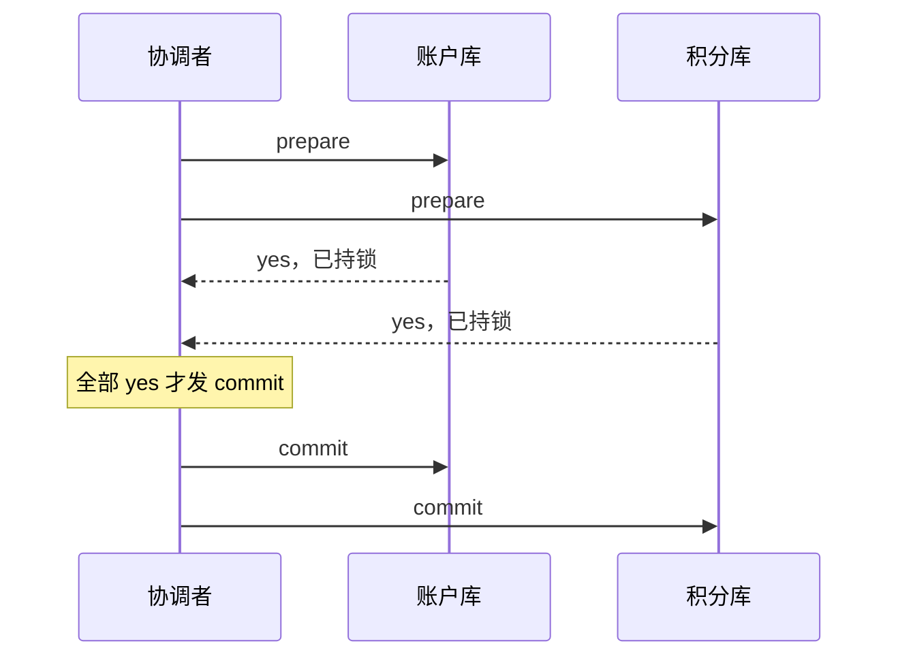

## Q
**2PC / XA 与 Seata AT · 为什么少用、AT 怎么自动回滚**｜追问

面试官：「跨账户库和积分库的转账，用 2PC 行不行？Seata 的 AT 模式又是怎么回滚的？」

## A
**基本回答。** 2PC（two-phase commit，两阶段提交）分两步：第一步 prepare，协调者问所有参与者「能不能提交」，参与者先把事务执行完但不提交，持着锁、写好日志回答 yes 或 no；第二步，全部 yes 才发 commit，只要有一个 no 就发 rollback。数据库的 XA 协议就是 2PC。它是同步阻塞的，协调者是单点，还可能不一致，吞吐低，也无法跨服务、跨语言通用，所以互联网业务很少用；只适合同一公司内、参与者少、并发低、要强一致的场景，比如库内跨分片事务。Seata 的 AT 模式把回滚做成自动的：一阶段先把修改前后的数据记进 `undo_log`，需要回滚时按记录生成反向 SQL。
3PC 多一个 CanCommit 阶段和超时，网络分区下仍可能不一致，基本不用。AT 三角色：TM 发起全局事务，RM 是数据源代理，TC 是协调者。
**先看图。**

先看 2PC：两个库都回答 yes 之后，协调者才发 commit；如果在发 commit 之前协调者崩溃，两个库就一直持着锁等着。
<svg xmlns="http://www.w3.org/2000/svg" viewBox="0 0 340 330">
<text x="8" y="16" text-anchor="acc" font-size="12" font-family="sans-serif" fill="currentColor">一阶段：每个 RM 本地提交 + 记 undo_log</text>
<rect x="6" y="26" width="168" height="30" rx="3" fill="none" stroke="currentColor" stroke-width="1.2"/>
<text x="90" y="45" text-anchor="middle" font-size="12" font-family="sans-serif" fill="currentColor">RM 拦截业务 SQL</text>
<rect x="6" y="66" width="168" height="30" rx="3" fill="none" stroke="currentColor" stroke-width="1.2"/>
<text x="90" y="85" text-anchor="middle" font-size="12" font-family="sans-serif" fill="currentColor">查 before image</text>
<line x1="90" y1="56" x2="90" y2="59" stroke-width="1.2" stroke="currentColor"/>
<polygon points="90.0,66.0 86.8,59.0 93.2,59.0" fill="currentColor" stroke="currentColor" stroke-width="0.5"/>
<rect x="6" y="106" width="168" height="30" rx="3" fill="none" stroke="currentColor" stroke-width="1.2"/>
<text x="90" y="125" text-anchor="middle" font-size="12" font-family="sans-serif" fill="currentColor">执行业务 SQL</text>
<line x1="90" y1="96" x2="90" y2="99" stroke-width="1.2" stroke="currentColor"/>
<polygon points="90.0,106.0 86.8,99.0 93.2,99.0" fill="currentColor" stroke="currentColor" stroke-width="0.5"/>
<rect x="6" y="146" width="168" height="30" rx="3" fill="none" stroke="currentColor" stroke-width="1.2"/>
<text x="90" y="165" text-anchor="middle" font-size="12" font-family="sans-serif" fill="currentColor">查 after image</text>
<line x1="90" y1="136" x2="90" y2="139" stroke-width="1.2" stroke="currentColor"/>
<polygon points="90.0,146.0 86.8,139.0 93.2,139.0" fill="currentColor" stroke="currentColor" stroke-width="0.5"/>
<rect x="6" y="186" width="168" height="30" rx="3" stroke-width="1.2" style="fill:var(--chip,rgba(59,111,212,0.12));stroke:var(--accent,#3b6fd4)"/>
<text x="90" y="205" text-anchor="middle" font-size="12" font-family="sans-serif" fill="currentColor">写 undo_log，同事务提交</text>
<line x1="90" y1="176" x2="90" y2="179" stroke-width="1.2" stroke="currentColor"/>
<polygon points="90.0,186.0 86.8,179.0 93.2,179.0" fill="currentColor" stroke="currentColor" stroke-width="0.5"/>
<rect x="6" y="226" width="168" height="30" rx="3" fill="none" stroke="currentColor" stroke-width="1.2"/>
<text x="90" y="245" text-anchor="middle" font-size="12" font-family="sans-serif" fill="currentColor">向 TC 注册，申请全局锁</text>
<line x1="90" y1="216" x2="90" y2="219" stroke-width="1.2" stroke="currentColor"/>
<polygon points="90.0,226.0 86.8,219.0 93.2,219.0" fill="currentColor" stroke="currentColor" stroke-width="0.5"/>
<text x="190" y="40" text-anchor="start" font-size="12" font-family="sans-serif" style="fill:var(--accent,#3b6fd4)">二阶段</text>
<rect x="190" y="50" width="144" height="30" rx="3" fill="none" stroke="currentColor" stroke-width="1.2"/>
<text x="262" y="69" text-anchor="middle" font-size="12" font-family="sans-serif" fill="currentColor">全局提交</text>
<line x1="262" y1="80" x2="262" y2="93" stroke-width="1.2" stroke="currentColor"/>
<polygon points="262.0,100.0 258.8,93.0 265.2,93.0" fill="currentColor" stroke="currentColor" stroke-width="0.5"/>
<rect x="190" y="100" width="144" height="30" rx="3" fill="none" stroke="currentColor" stroke-width="1.2"/>
<text x="262" y="119" text-anchor="middle" font-size="12" font-family="sans-serif" fill="currentColor">异步删 undo_log</text>
<rect x="190" y="160" width="144" height="30" rx="3" fill="none" stroke="currentColor" stroke-width="1.2"/>
<text x="262" y="179" text-anchor="middle" font-size="12" font-family="sans-serif" fill="currentColor">全局回滚</text>
<line x1="262" y1="190" x2="262" y2="201" stroke-width="1.2" stroke="currentColor"/>
<polygon points="262.0,208.0 258.8,201.0 265.2,201.0" fill="currentColor" stroke="currentColor" stroke-width="0.5"/>
<rect x="190" y="208" width="144" height="30" rx="3" fill="none" stroke="currentColor" stroke-width="1.2"/>
<text x="262" y="227" text-anchor="middle" font-size="12" font-family="sans-serif" fill="currentColor">after image 校验</text>
<line x1="262" y1="238" x2="262" y2="249" stroke-width="1.2" stroke="currentColor"/>
<polygon points="262.0,256.0 258.8,249.0 265.2,249.0" fill="currentColor" stroke="currentColor" stroke-width="0.5"/>
<rect x="190" y="256" width="144" height="30" rx="3" stroke-width="1.2" style="fill:var(--chip,rgba(59,111,212,0.12));stroke:var(--accent,#3b6fd4)"/>
<text x="262" y="275" text-anchor="middle" font-size="12" font-family="sans-serif" fill="currentColor">反向 SQL 恢复</text>
<text x="8" y="304" text-anchor="dim" font-size="12" font-family="sans-serif" fill="currentColor">TM 发起全局事务 · RM 是数据源代理 · TC 是协调者</text>
<text x="8" y="322" text-anchor="dim" font-size="12" font-family="sans-serif" fill="currentColor">本地锁一阶段后释放，写冲突靠全局锁</text>
</svg>
再看 Seata AT：左边是一阶段，每个服务自己提交本地事务并留下 undo_log；右边二阶段，提交只是删日志，回滚才用日志反向恢复。
**举个例子。** 账户库给用户 U1 扣 100，积分库给 U1 加 100 积分，用 Seata AT：
1. **一阶段·账户库：** 拦截 `UPDATE account SET balance=balance-100 WHERE id=1`；before image 是 balance=500，执行后 after image 是 balance=400；两份写入 `undo_log`，和扣款同一个本地事务提交，本地行锁随即释放；向 TC 申请这一行的全局锁。
2. **一阶段·积分库：** 同样处理，积分 20 变 120，也留下 undo_log。
3. **全部成功：** TM 通知 TC 全局提交，两个库各自异步删掉 undo_log，结束。
4. **积分库失败：** TC 通知账户库回滚。RM 先拿 after image（balance=400）和当前行比较：一致，就执行反向 SQL 把 balance 改回 500。
5. **回滚失败：** 如果这期间有一个没走全局事务的普通 SQL 把 balance 改成了 350，校验不一致，回滚失败，需要人工处理。所以对这张表的写都应走全局事务。
**容易错。**
- **以为 AT 是强一致：** 本地锁一阶段后就释放，别人能读到未全局提交的数据，是读未提交。
- **把 2PC 当成 Raft：** 一个让副本一致，一个让不同资源一起提交，容错能力完全不同。
- **以为全局锁就是行锁：** 它防的是两个全局事务写同一行，保证回滚时 before image 不会覆盖别人。
- **只想着 2PC 慢：** 更可怕的是协调者崩溃时参与者无法自己决定，会长时间持锁。
- **对热点账户用 AT：** 全局锁竞争严重，热点用 TCC 或本地事务加 MQ。
