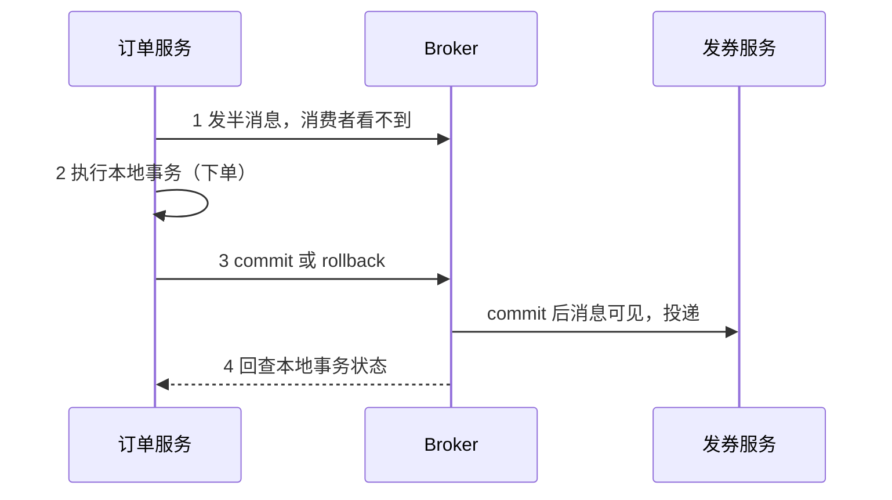

## Q
**事务消息（半消息）· 本地事务和发消息怎么一致**｜追问

面试官：「订单本地事务提交成功，才能发出『发券』消息，两者怎么做到要么都成要么都不成？」

## A
**基本回答。** 以 RocketMQ 事务消息为例，四步：① 先把半消息（half message）发到 Broker，Broker 收下但对消费者不可见；② 执行本地事务；③ 按本地事务的结果给 Broker 发 commit（消息变可见）或 rollback（消息删除）；④ 如果迟迟收不到第 ③ 步（比如生产者崩溃了），Broker 会回查生产者这笔本地事务的状态，再决定提交还是回滚。这样「本地事务」和「发消息」要么都成、要么都不成。
**先看图。**

正常路径是 1、2、3 再投递；第 4 步是兜底，只有第 3 步没到达时 Broker 才会回查。
**举个例子。** 订单 O-9001 下单成功后要发券：
1. **半消息：** 订单服务先发「给 O-9001 发券」的半消息，Broker 收下，发券服务这时看不到。
2. **本地事务成功：** 订单服务写入订单 O-9001，提交，再发 commit；消息变可见，发券服务收到并发券。
3. **本地事务失败：** 如果下单失败（库存不足），订单服务发 rollback，半消息被删，不会有人发出无主的券。
4. **提交前崩溃：** 订单服务写完订单，在发 commit 之前崩溃。Broker 等不到结果，回查「O-9001 的本地事务状态」。
5. **回查判断：** 回查接口去订单表查，O-9001 存在就回答 commit，消息变可见；查不到就回答 rollback。
**容易错。**
- **以为不用幂等：** 回查和重投都可能带来重复，消费端仍要幂等。
- **忘了写回查接口：** 没有它，生产者崩溃后半消息会一直悬着。
- **业务表里没有可查的状态：** 回查时无法判断本地事务有没有提交。
- **以为 Kafka 也有半消息：** Kafka 的事务不能和业务库原子提交。
