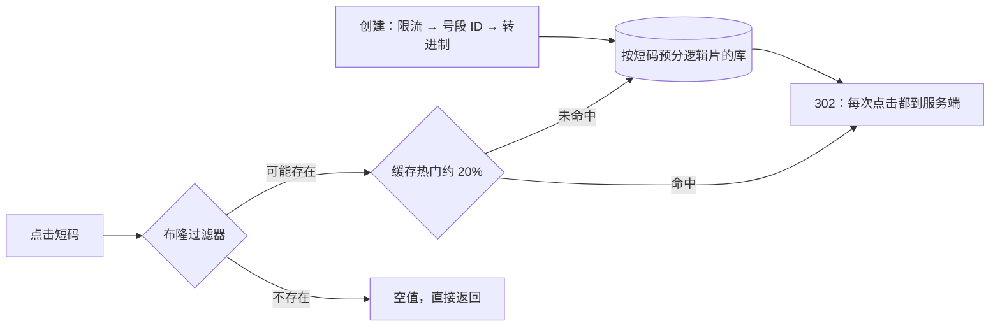

## Q
**短链接服务（URL Shortener / TinyURL） · 会被追问哪些八股**｜必会

设计短链接服务（URL Shortener / TinyURL）时，面试官最可能从哪几步下钻到基础知识？每一步问什么，怎么答？

## A
**基本回答。** 读写比约一千比一的键值查找。基础是：分布式 ID 与 B+ 树追加写、301 与 302 的缓存差异、缓存容量与穿透、分片、限流与幂等。

**下钻路线。**
- 短码怎么不冲突 → 号段或雪花趋势递增 ID，再转进制，[[b.distributed.distributed-id|全局唯一 ID]]
- 为什么不用 UUID → 无序主键让页分裂，自增 ID 追加写，[[a.mysql.bplus-tree|为什么 MySQL 索引用 B+ 树]]
- 301 还是 302 → 301 被浏览器缓存，后续点击统计不到，[[b.net.http-basics-cache|HTTP 基础]]
- 缓存要多大 → 只缓存热门约 20%，条数 × 单条大小 ÷ 0.7，[[b.cache.hit-rate|缓存命中率与容量估算]]
- 不存在的短码 → 布隆过滤器加空值，追问过滤器多大、新码怎么加入，[[a.cache.penetration|缓存穿透]]
- 短码怎么分片、扩容不搬数据 → 预分逻辑片，[[a.mysql.sharding|分库分表]]
- 防批量创建 → 固定窗口边界会被薅，用滑动窗口或令牌桶，[[a.protect.rate-limit-algorithms|限流算法]]
- 短码用哈希还是自增 → 哈希有碰撞要重试，自增无碰撞但可枚举；热点短链再分缓存层，[[b.scenario.short-link|短链接系统设计]]

**业务场景。** 收款二维码的短链带订单号，点击统计和缓存会冲突：用 302 才能每次点击都到达服务端。
**系统设计。** [[links.distributed-rate-limiter|分布式限流器（Rate Limiter）]]：创建接口的限流机制同源；[[links.distributed-cache|分布式缓存（Redis）]]：短码映射放缓存，那里讲缓存节点内部的淘汰与高可用。
