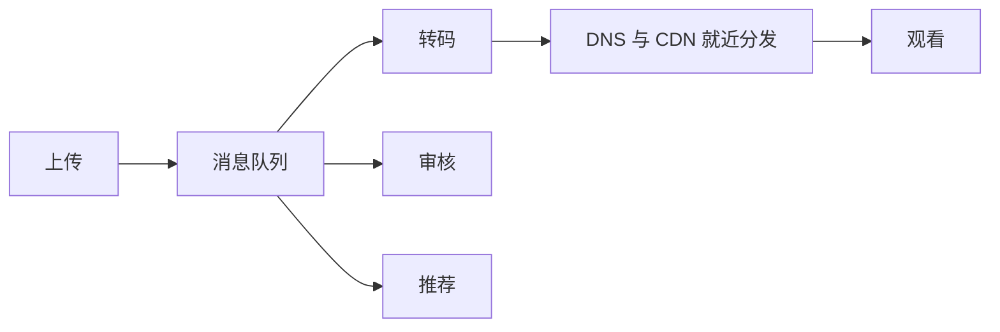

## Q
**视频平台（YouTube） · 会被追问哪些八股**｜必会

设计视频平台（YouTube）时，面试官最可能从哪几步下钻到基础知识？每一步问什么，怎么答？

## A
**基本回答。** 上传后的异步流水线加全球分发。基础是：消息队列解耦转码审核推荐、积压排查、重试预算防放大、多级缓存、DNS 与 CDN 就近、零拷贝文件分发。

**下钻路线。**
- 转码、审核、推荐怎么解耦 → 发消息，分区加消费者组，并发度由分区数决定，[[a.mq.kafka-architecture|Kafka 整体结构]]
- 转码服务挂了用户看到什么 → 最终一致，显示处理中并可重试，[[b.mq.why-mq|为什么用消息队列]]
- 某个视频一直转码不出来 → 查是毒消息还是下游转码集群慢，[[a.mq.backlog|消息积压怎么办]]
- 上传、转码、存储多级调用 → 只在一层重试并设预算，避免级联放大，[[a.protect.retry|重试的原则与为什么不能无限重试]]
- 热门视频元数据读 QPS 极高 → 本地 Caffeine 加 Redis 两级缓存，[[b.cache.multilevel|多级缓存设计与冷启动]]
- 起播慢怎么定位 → 分段计时：解析、建连、首字节、CDN 命中，[[b.linux.network-slow|网络慢或连不上]]
- 怎么就近拿到视频 → DNS 或 CDN 调度返回最近节点，生效时间看 TTL，[[b.net.dns|DNS 解析过程]]
- 分发层为什么用 Nginx 加 sendfile → 零拷贝省 CPU，资源花在连接上，[[b.net.io-pagecache-zerocopy|文件 I/O]]

**业务场景。** 抖音视频发布后转码消息积压：用户看到「处理中」，不会看到失败，积压期间不影响已发布内容的播放。
**系统设计。** [[links.video-moderation-system|视频内容审核系统]]：同样的上传后异步流水线，多了规则引擎与处置的幂等；[[links.dropbox|文件存储（Dropbox）]]：同样的分块上传续传，差别是视频后面还有转码与自适应码率。
