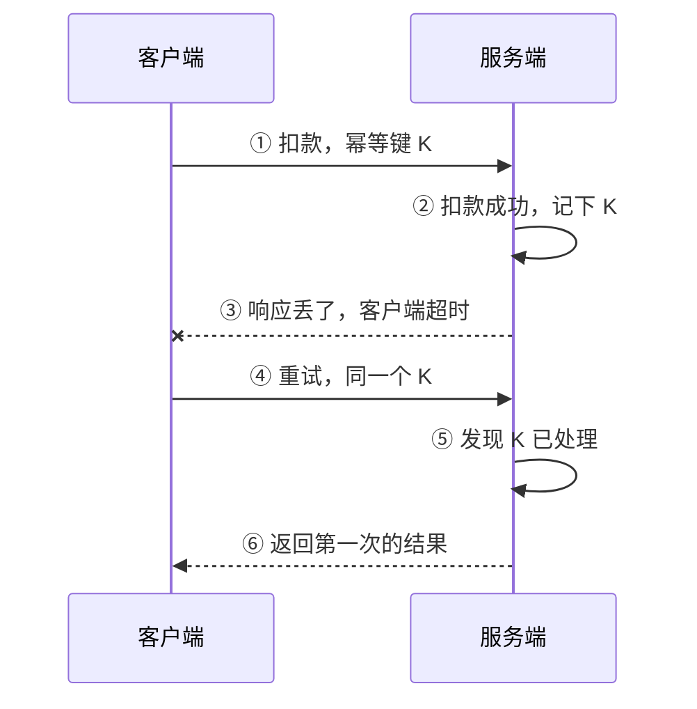

## Q
**重试 · 重试和幂等有什么关系**｜追问

面试官：「扣款请求超时了，你重试了一次，用户被扣了两次。问题出在哪？重试的前提是什么？」

## A
**基本回答。** 超时只说明没收到响应，不说明没执行：服务端可能已经执行，只是响应在路上丢了。重试会让同一请求执行多次，所以写操作重试的前提是幂等（执行一次和多次结果相同）：重试制造重复，幂等消化重复，必须成对。做法：客户端为每个逻辑操作生成幂等键（UUID，重试时复用同一个；或业务字段派生如订单号加动作类型），服务端对键建唯一约束并保存请求哈希，同一键参数不同要报错，键保留得比最长重试窗口更久，重复请求返回第一次的结果。常见手段：唯一请求 ID、数据库唯一约束（创建类）、乐观锁（更新类）、状态机（订单、支付）；HTTP 里 PUT、DELETE、GET 按规范幂等，POST 默认不幂等。超时的写请求不要直接判失败：带同一键重试，或用请求号查询状态，结果仍不确定就标记处理中，最后靠对账兜底。
**先看图。**

扣款其实成功了，只是响应没回来；客户端带同一个键重试，服务端认出已处理，返回第一次的结果，只扣一次。
**业务场景。** 用户付 100 元，客户端用商户订单号 `ORD-77` 作幂等键：第一次扣款成功记下流水号 T1，响应丢了；超时后带同一个键重试，服务端查到已存在，直接返回 T1，只扣 100。若键相同但金额变成 200，请求哈希对不上，报错而不当作重复；没有幂等键则被当新扣款，扣了 200。
**容易错。**
- **重试不带幂等键。**
- **每次重试都生成新键。**
- **键保留得太短。**
